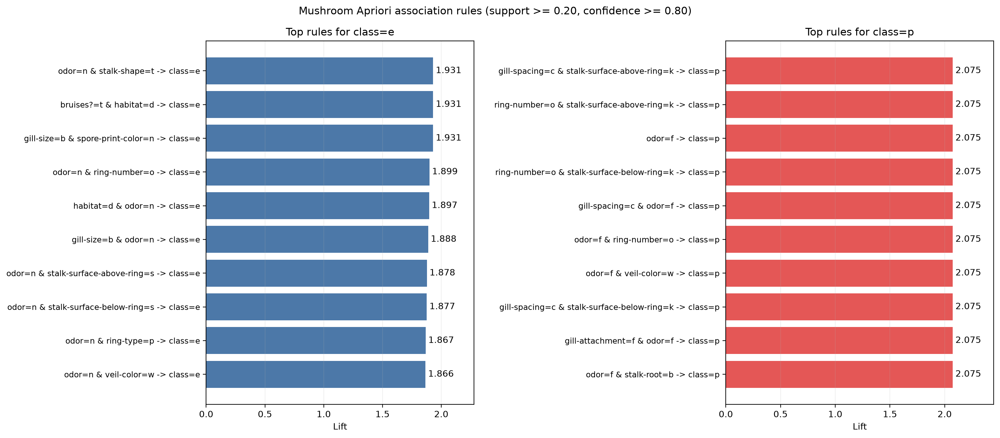

# Mushroom Apriori 结果摘要

以 Support≥0.20、Confidence≥0.80、最大项集长度 3 挖掘到 1568 个频繁项集，其中 104 条为后件指向 `class=e/p` 的关联规则。

## 可食类别 Top 规则（按 Lift 排序）

- `odor=n & stalk-shape=t → class=e`：Support=0.3072，Confidence=1.0000，Lift=1.9306。
- `bruises?=t & habitat=d → class=e`：Support=0.2245，Confidence=1.0000，Lift=1.9306。
- `gill-size=b & spore-print-color=n → class=e`：Support=0.2029，Confidence=1.0000，Lift=1.9306。
- `odor=n & ring-number=o → class=e`：Support=0.3545，Confidence=0.9836，Lift=1.8990。
- `habitat=d & odor=n → class=e`：Support=0.2196，Confidence=0.9824，Lift=1.8966。

## 有毒类别 Top 规则（按 Lift 排序）

- `gill-spacing=c & stalk-surface-above-ring=k → class=p`：Support=0.2742，Confidence=1.0000，Lift=2.0746。
- `ring-number=o & stalk-surface-above-ring=k → class=p`：Support=0.2698，Confidence=1.0000，Lift=2.0746。
- `odor=f → class=p`：Support=0.2659，Confidence=1.0000，Lift=2.0746。
- `ring-number=o & stalk-surface-below-ring=k → class=p`：Support=0.2659，Confidence=1.0000，Lift=2.0746。
- `gill-spacing=c & odor=f → class=p`：Support=0.2659，Confidence=1.0000，Lift=2.0746。

Lift>1 表示属性组合与类别正相关；Confidence 表示该条件下类别出现的比例。规则反映当前数据的共现关系，不证明因果关系，也不应与分类模型直接比较 F1。完整规则见 `class_association_rules.csv`。
