# Mushroom 与 Ionosphere 的对比数据挖掘研究

**CDS535 - Data Mining**  
**Team Name：** [待填写]  
**成员：** A1 贺浩东｜A2 贝学成｜A3 顾瑞祺｜B1 公汀露｜B2 何铭恩｜B3 胡率帅  
**Student IDs：** [待填写]  
**Instructor：** [待填写]  
**Date：** 2026 年 11 月

## Abstract

本项目比较传统数据挖掘方法在 UCI Mushroom 与 Ionosphere 数据集上的表现，统一采用分层 10 折交叉验证、80/20 切分和 `seed=42`，结合 F1、ROC-AUC、错误结构与模型成本进行评价。Mushroom 使用 ZeroR、J48、逻辑回归、KNN 和 Apriori，多种候选模型满分并列后选择逻辑回归。Ionosphere 使用决策树、RandomForest、逻辑回归和 RBF-SVM，RBF-SVM 以 F1=0.956、ROC-AUC=0.980 获得最佳综合表现。研究表明，模型优势具有数据依赖性：Mushroom 的强类别信号使简单模型已足够，而 Ionosphere 的非线性数值边界使核方法更有优势。

**Keywords:** Data Mining; Classification; Association Rules; Mushroom; Ionosphere; Cross-validation

## Contents

[排版时自动生成目录及页码。]

## 1 Group Project Requirement

### 1.1 Project Objectives and Scope

两个 UCI 数据集均执行“数据检查—预处理—建模—评估”的完整流程。分类以目标正类 F1 为主指标、ROC-AUC 为次指标，同时报告 Accuracy、Precision、Recall 和混淆矩阵；无监督组件采用 Apriori 和 KMeans。所有随机过程使用 `seed=42`，监督预处理在训练折内完成，避免数据泄露。

### 1.2 Division of Labour

| 成员     | 数据集/角色     | 具体贡献                                 |
| ------ | ---------- | ------------------------------------ |
| A1 贺浩东 | Mushroom   | 预处理、J48 内部方案、树图及 Weka 工作流            |
| A2 贝学成 | Mushroom   | 逻辑回归、KNN、折内调参、Apriori 与图表            |
| A3 顾瑞祺 | Mushroom   | ZeroR、结果汇总、报告与 PPT 辅助                |
| B1 公汀露 | Ionosphere | 预处理、J48、消融与可视化                       |
| B2 何铭恩 | Ionosphere | RandomForest、Logistic、训练曲线与泄露检查      |
| B3 胡率帅 | Ionosphere | RBF-SVM、PCA/SelectKBest、结果汇总与 PPT 整合 |

## 2 Introduction

### 2.1 Background and Motivation for Research

Mushroom 的可食性识别和 Ionosphere 的雷达回波识别均为二分类任务，但数据特性显著不同。前者样本较多、属性全部为名义类型并含缺失值，后者样本少、数值维度较高且类别轻度不平衡。该差异为研究预处理与算法适配性提供了直接对照。

Accuracy 在类别不平衡或基线较强时可能掩盖关键类别失败，因此本项目以 F1 为核心，并用 ROC-AUC、混淆矩阵和错误类型补充评价。

### 2.2 Research Implication

- **RQ1**：共同的 J48 与逻辑回归在两个数据集上的 F1、ROC-AUC 和错误结构有何差异？
- **RQ2**：加入各数据集适用的候选模型后，额外模型复杂度是否带来足够收益？
- **RQ3**：属性类型、样本规模和数据质量分别需要哪些预处理，这些选择如何影响结果？
- **RQ4**：无监督簇与真实类别的一致程度如何，聚类能否替代监督分类？

### 2.3 Key Points of Innovation

- 使用统一的 `seed=42`、分层 10 折和 80/20 协议，提高可复现性。
- 将 One-Hot、标准化、监督特征选择与重采样放在训练折内，降低泄露风险。
- 先在算法内部筛选方案，再按 F1 → ROC-AUC → 错误结构 → 复杂度横向择优。
- 将分类与无监督分析分开报告，避免混用分类、关联和聚类指标。

## 3 Data Distribution and Preprocessing

### 3.1 Data Visualisation and Analysis

#### 3.1.1 Mushroom

Mushroom 由 Schlimmer（1987）提供，DOI 为 [10.24432/C5959T](https://doi.org/10.24432/C5959T)，采用 CC BY 4.0 许可。原始数据有 8124 条样本、22 个名义输入属性，标签为可食 `e` 和有毒 `p`。

`stalk-root` 含 2480 个缺失值，`veil-type` 只有一个取值。清洗后保留 21 个有效输入属性；可食 4208 条、有毒 3916 条，比例约为 51.80%:48.20%，类别近似平衡。

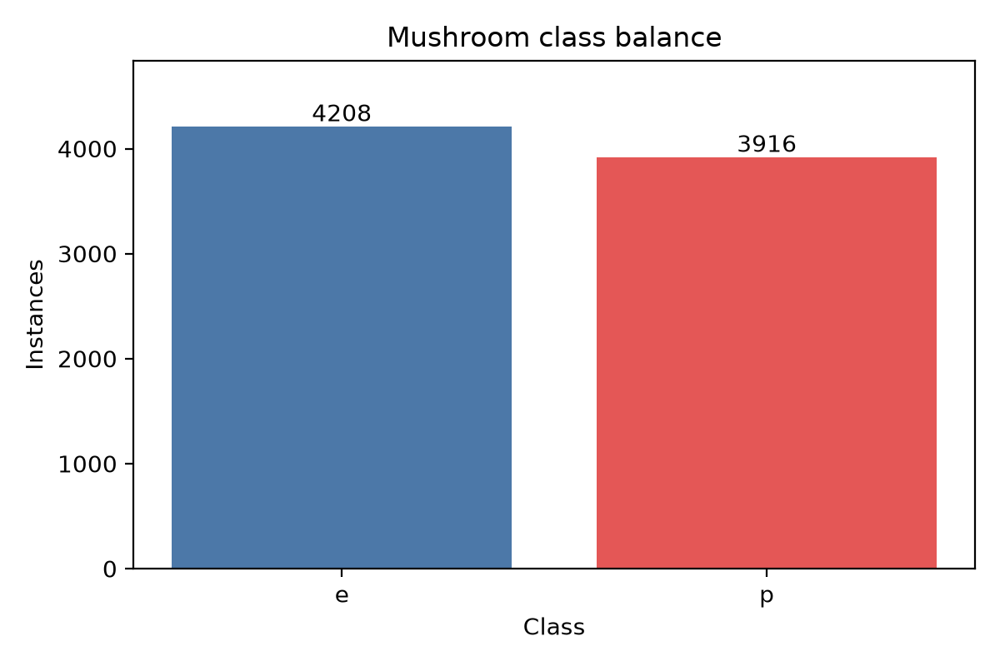

#### 3.1.2 Ionosphere

Ionosphere 由 Johns Hopkins University Applied Physics Laboratory 的 Vince Sigillito 等提供，UCI ID 为 52，DOI 为 [10.24432/C5W01B](https://doi.org/10.24432/C5W01B)，采用 CC BY 4.0 许可。数据来自 Goose Bay 的 16 根高频天线系统，`good` 表示存在可识别电离层结构，`bad` 表示信号直接穿过。

数据包含 351 条样本、34 个数值输入属性，由 17 组脉冲信号的实部与虚部构成。`a02` 为全零常量属性，处理后保留 33 个输入属性；无缺失值。good 225 条（64.1%）、bad 126 条（35.9%），呈轻度不平衡，评估以 `good` 为正类。

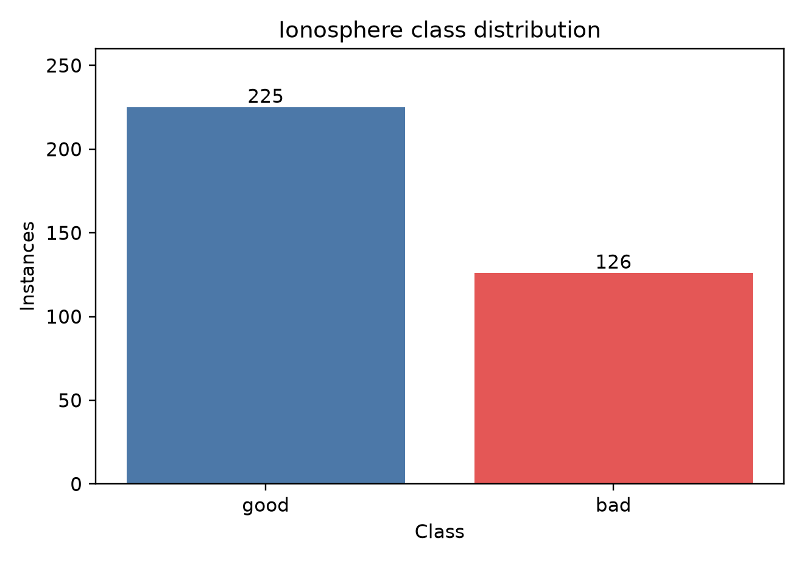

### 3.2 Data Preprocessing

#### 3.2.1 Mushroom 通用预处理

- `ReplaceMissingValues` 以众数填补 `stalk-root`，避免删除大量样本。
- `RemoveUseless -M 99.0` 删除单值属性 `veil-type`；清洗后无完全重复样本。
- `AttributeSelection（InfoGainAttributeEval + Ranker，numToSelect=-1）` 仅按信息增益对属性排序，不删除任何属性，用于识别 `odor`、`spore-print-color` 等较强属性；真正的降维在 J48 的折内 `FilteredClassifier` 中完成。
- `NominalToBinary` 将 21 个名义输入属性展开为 115 个二元属性，形成统一的数值表示；实际转换在训练折内拟合，避免预处理泄露。
- 所有输入均为名义属性，不使用 IQR 或 Z-score 删除低频类别。

#### 3.2.2 Ionosphere 通用预处理

- 检查缺失值；`ReplaceMissingValues` 保留为一致性步骤，实际无缺失值需要处理。
- 使用 `RemoveUseless` 删除全零常量属性 `a02`，保留 33 个有效数值属性。
- 数值属性不执行 One-Hot，保留原始连续信息。
- 检查极端数值，但不将合理的强回波信号直接视为离群样本删除。
- 保留 1 条重复记录，避免在缺少依据时改变样本分布。

#### 3.2.3 Workflow Differences

| 步骤 | Mushroom | Ionosphere |
|---|---|---|
| 缺失值 | `stalk-root` 众数填补 | 无缺失 |
| 无效属性 | 删除单值 `veil-type` | 删除全零 `a02` |
| 属性转换 | 通用 `NominalToBinary` 至 115 维 | 保留数值输入 |
| 模型专属处理 | J48 折内特征选择 | Standardize、SelectKBest、PCA、重采样按管线执行 |
| 防泄露 | `FilteredClassifier` / sklearn Pipeline | sklearn Pipeline |

Weka 3.8.7 Explorer 用于过滤器、ZeroR、J48、RandomForest、Logistic 和交叉验证，保存模型、日志和命令。Python 与 scikit-learn 用于逻辑回归、KNN、RBF-SVM、固定索引、折内调参、图表和 Apriori。统一对比表由可复现输出生成，属于原始要求允许的 Experimenter 等价方案。

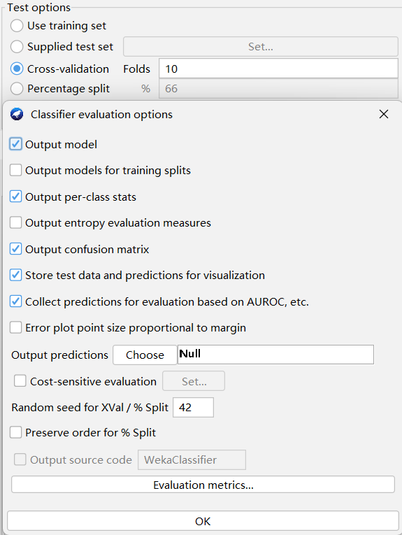

## 4 Basic Concepts of Algorithms

- **ZeroR**：始终预测多数类，用于判断其他模型是否真正学习了类别规律。
- **J48/决策树**：递归选择分裂属性形成规则；J48 基于信息增益并剪枝，Python 对照使用优化版 CART。
- **逻辑回归**：对输入特征加权并通过 Sigmoid 输出类别概率，提供稳定的线性参照。
- **KNN**：根据最近邻样本标签投票，检验 Mushroom 类别属性的局部相似性。
- **RandomForest**：通过 Bootstrap 和随机特征子集构建多棵树并投票，降低单树方差。
- **RBF-SVM**：利用最大间隔和 RBF 核学习非线性边界，适合小样本数值数据。
- **Apriori**：挖掘频繁项集和关联规则，以 Support、Confidence、Lift 衡量共现关系。
- **KMeans**：在无标签条件下最小化簇内 SSE，以轮廓系数及外部标签对照分析聚类结构。

## 5 Model Training

### 5.1 Model Initialization and Configuration

正式分类指标使用 `seed=42`、分层 10 折交叉验证和分层 80/20 切分。同名 J48 与逻辑回归统一使用训练/验证 F1、ROC-AUC 学习曲线；RandomForest 使用 OOB 曲线，RBF-SVM 使用特征数量敏感性曲线。传统模型的曲线不解释为统一的逐批次 loss。

| 数据集 | 模型 | 固定参数 | 搜索/选择设置 |
|---|---|---|---|
| Mushroom | ZeroR | 多数类规则 | 无 |
| Mushroom | J48-top9 | `C=0.25, M=2` | 折内 InfoGain top9 |
| Mushroom | 逻辑回归 | L2、lbfgs、max_iter=5000 | `C=0.01～100`；holdout 训练部分 C=10 |
| Mushroom | KNN | Euclidean | `k=1～20`；uniform/distance；并列记录 k=1、uniform |
| Ionosphere | 决策树 | `min_samples_leaf=2, min_samples_split=4` | 特征选择与深度消融 |
| Ionosphere | RandomForest | 100 树、Bootstrap、随机特征子集 | OOB 曲线检查树数量平台 |
| Ionosphere | Logistic | L-BFGS、max_iter=5000 | 比较预处理管线 |
| Ionosphere | RBF-SVM | RBF 核、默认 C/gamma | Standardize、SelectKBest/PCA、SMOTE |

### 5.2 Mushroom 训练过程与内部筛选

#### ZeroR

##### Model Training

ZeroR 仅提供多数类基线，不进入最终候选。

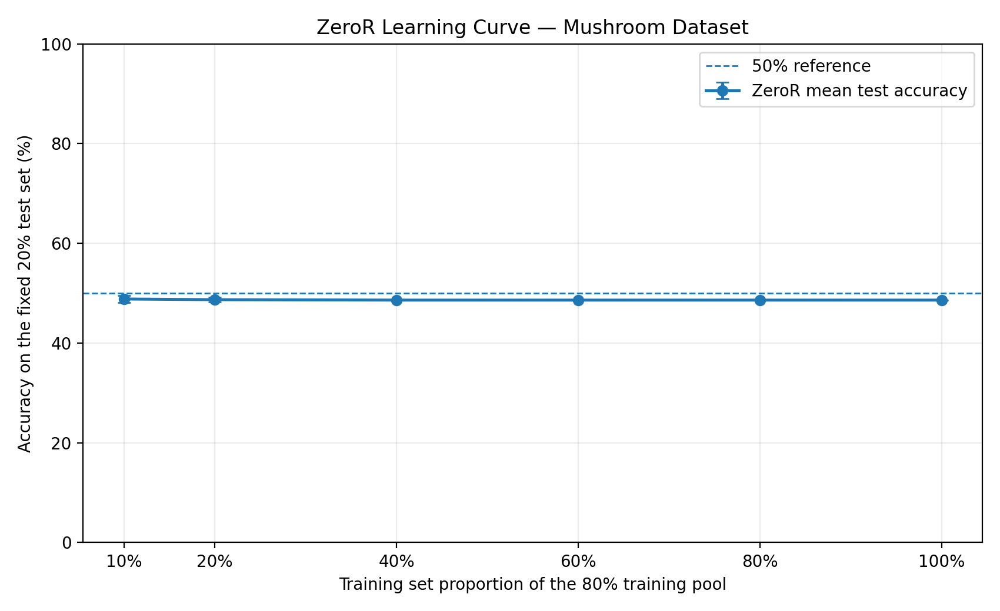

#### J48

##### Additional Preprocessing

在通用 `NominalToBinary` 表示之外，J48 通过 `FilteredClassifier` 在每个训练折内执行 InfoGain、CFS 或 Wrapper 属性选择，避免测试折参与特征筛选。

##### Model Training

J48 内部比较全属性、InfoGain top8/top9、CFS 和 Wrapper。CFS 和 top8 出现有毒漏检；all22、top9、Wrapper 均满分。top9 比 all22 使用更少属性，并避免 Wrapper 的高成本搜索与更复杂结构，因此仅保留 **J48-top9** 进入横向比较。

| 内部方案 | 属性数 | 10 折有毒漏检数 | F1 | 结构/成本 |
|---|---:|---:|---:|---|
| all22 | 21 | 0 | 1.0000 | 25 叶 |
| top8 | 8 | 8 | 0.9990 | 27 叶 |
| **top9** | **9** | **0** | **1.0000** | **28 叶** |
| CFS | 4 | 80 | 0.9898 | 17 叶 |
| Wrapper | 5 | 0 | 1.0000 | 32 叶，搜索成本更高 |

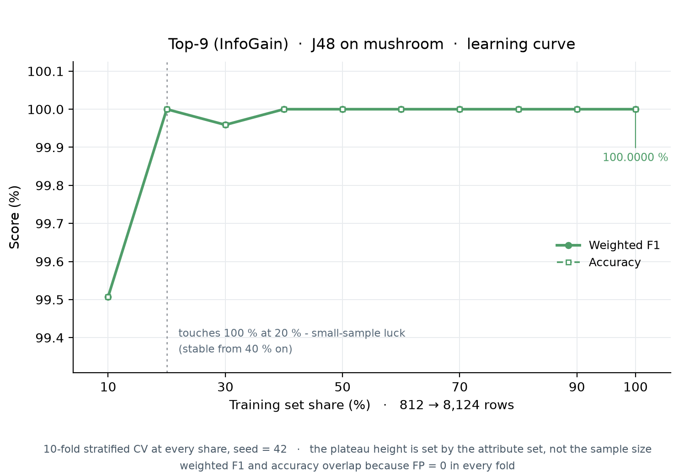

训练与验证表现随样本增加趋于一致，未见明显泛化缺口。

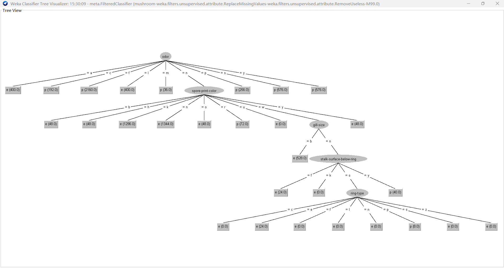

#### 逻辑回归

##### Model Training

验证 F1 与 ROC-AUC 随样本增加达到 1.0，训练—验证差距消失，说明线性组合在该数据上已经充分。

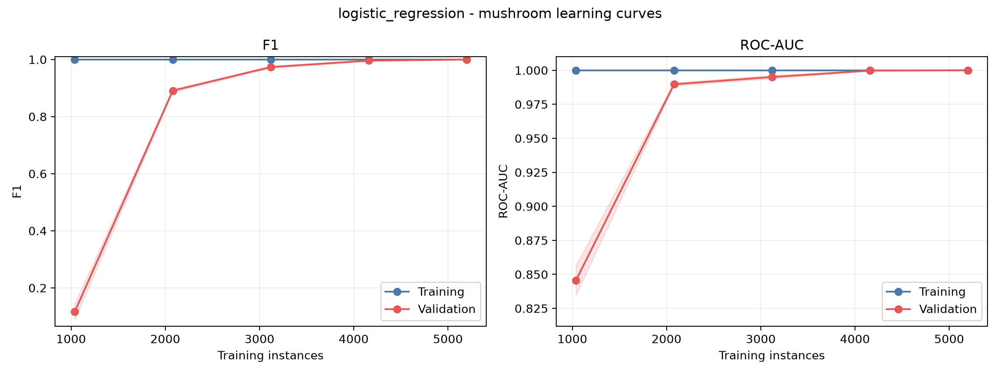

#### KNN

##### Model Training

KNN 在 `k=1～9` 时均获满分，网格搜索按并列顺序记录 `k=1、weights='uniform'`。`k=1` 的训练分数天然为 1，因此泛化判断依据验证曲线和外层交叉验证。

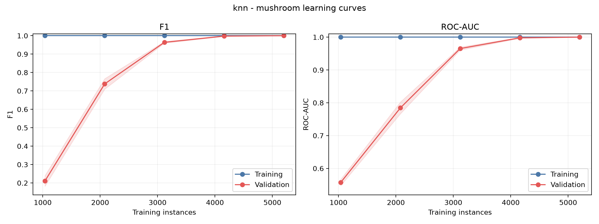

### 5.3 Ionosphere 训练过程

#### J48

##### Additional Preprocessing

在训练管线内分别测试 Standardize 和 InfoGain Top16，用于区分尺度变换与监督属性选择的影响。

##### Model Training

标准化消融中 F1 保持 0.9011，说明单调尺度变换不改变树分裂；InfoGain Top16 将 F1 提至 0.9173、ROC-AUC 提至 0.9125，体现小样本高维数据中的属性选择作用。

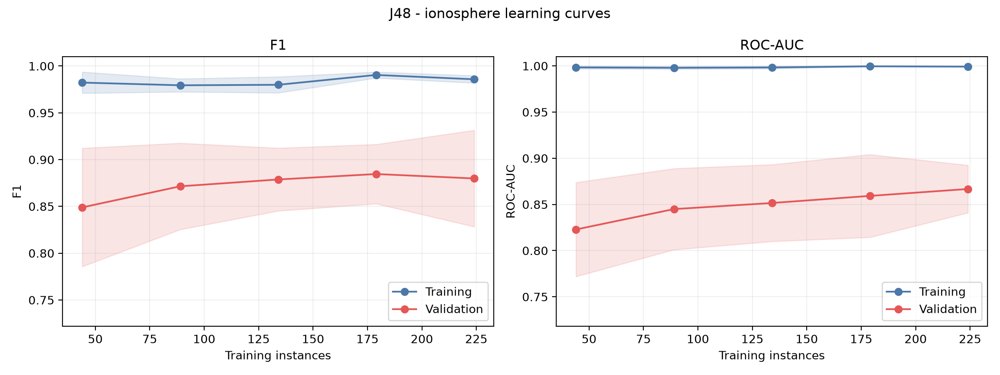

训练分数高于验证分数，增加样本后验证 F1 和 ROC-AUC 总体上升但仍有波动。

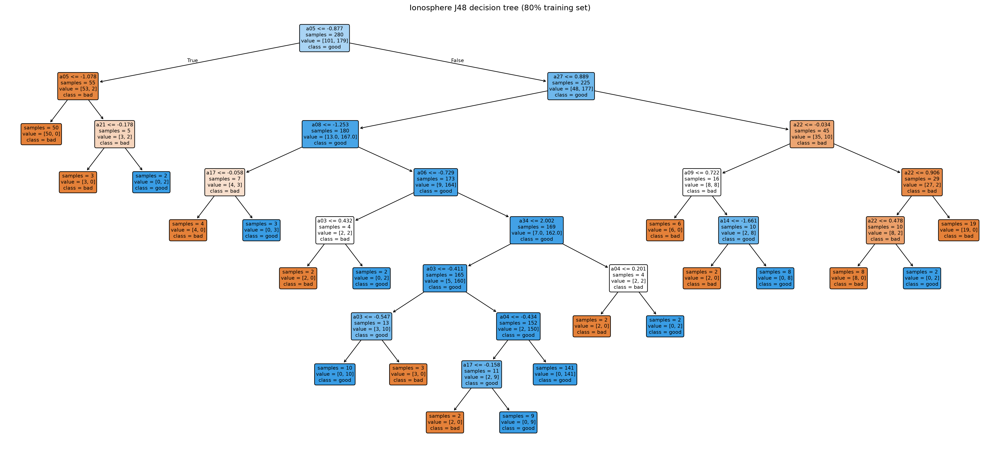

树图展示各数值属性的分裂阈值、节点样本量和类别构成，与 Mushroom 一样提供可检查的规则结构。

#### RandomForest

##### Additional Preprocessing

在训练折内比较无选择/无平衡、SelectKBest、RandomOverSampler 和 SMOTE 管线。RandomOverSampler 方案的 Accuracy 略高，但各方案总体差距较小，说明随机森林对这些预处理调整相对不敏感。

##### Model Training

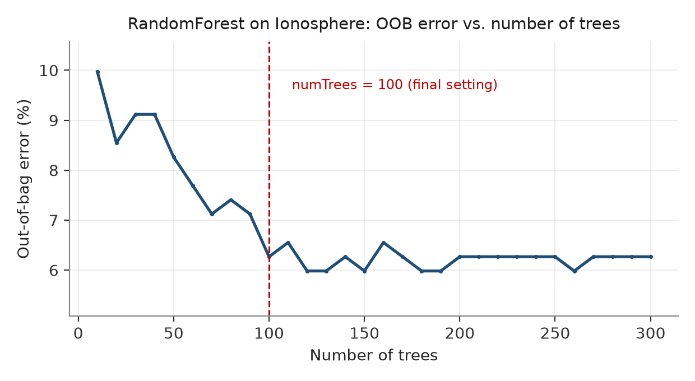

OOB 错误率由 10 棵树的约 10% 降至 100 棵时的约 6.3%，之后主要在 6%–6.7% 间波动，因此 100 棵是性能与计算成本的合理折中。

#### Logistic

##### Additional Preprocessing

逻辑回归比较相同的折内预处理管线，未选择且不平衡的方案收益最大。特征选择或重采样未改善其线性输入结构，Recall 较高而 Precision 相对较低。

##### Model Training

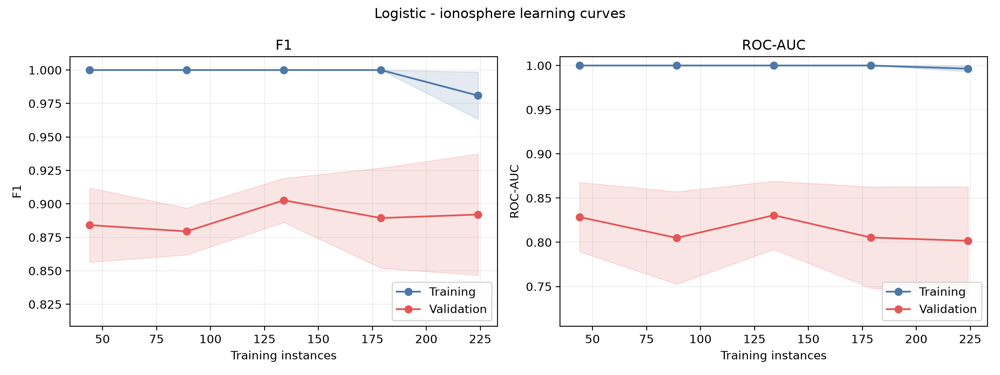

训练分数接近满分，而验证 F1 和 ROC-AUC 较低且波动，显示训练—验证差距。

#### RBF-SVM

##### Additional Preprocessing

所有方案在折内依次完成 Standardize、特征处理和可选重采样，再输入 SVM。

##### Model Training

SelectKBest+SMOTE 在基础扫描中表现较好；进一步扫描显示 `k=30` 时 Accuracy=0.957、F1=0.967，且 F1 标准差为 0.015，低于 `k=15` 的 0.031。

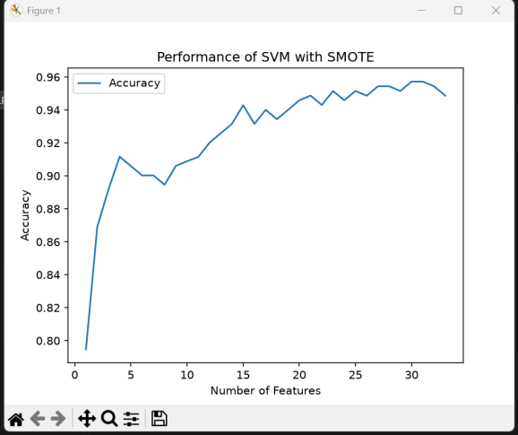

**PCA 主成分数量实验。** 为考察相关数值属性的压缩效果，每个训练折先执行 Standardize，再用 PCA 提取 `k=1～33` 个主成分，随后进行 SMOTE 和 RBF-SVM 分类。标准化避免量纲较大的属性主导方差方向；PCA 按训练折的方差结构提取正交主成分，不使用类别标签。

| 主成分数 k | Accuracy（约） | 中间结果与含义 |
|---:|---:|---|
| 1 | 0.795 | 单一主成分只保留主要方差方向，类别信息损失明显 |
| 10 | 0.940 | 增加主成分后判别信息快速恢复，已接近较高表现 |
| 15 | 0.943 | 提升开始趋缓，新增成分的边际收益下降 |
| 29 | 0.9577 | 达到本次 PCA 扫描的最高 Accuracy，信息保留较充分 |
| 33 | 略有回落 | 保留全部维度并未继续提升，后续成分可能主要承载冗余或噪声 |

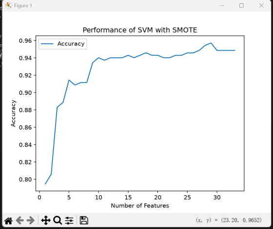

曲线呈现“快速上升—进入平台—小幅波动”的过程，而不是主成分越多越好。PCA 能将相关属性压缩到较少的正交方向，但主成分不直接对应原始雷达属性，解释性较弱；其最高 Accuracy=0.9577 与 SelectKBest 的 0.9572 仅相差约 0.0005，不能据此认定 PCA 更优。SelectKBest 利用训练折标签保留原特征，解释更直观；PCA 不使用标签，更适合压缩相关结构。

### 5.4 无监督组件训练

#### Apriori（Mushroom）

##### Model Training

Apriori 使用 Support≥0.20、Confidence≥0.80、最大项集长度 3，筛选后件为 `class=e/p` 的规则。

#### KMeans（Ionosphere）

##### Additional Preprocessing

聚类前执行 Standardize，并在探索实验中比较不同 SelectKBest 特征数量，避免尺度或无关维度主导距离。

##### Model Training

KMeans 在标准化属性上比较簇数和特征数量，以 SSE、轮廓系数及标签纯度评价。SelectKBest 使用标签辅助的探索结果单独标注，不与完全无监督结果混同。

## 6 Results and Evaluation

### 6.1 Mushroom：F1 与 ROC-AUC 横向比较

| 模型 | Accuracy | Precision | Recall | F1 | ROC-AUC |
|---|---:|---:|---:|---:|---:|
| ZeroR | 0.5180 | 0.0000 | 0.0000 | 0.0000 | 0.5000 |
| **J48-top9** | **1.0000** | **1.0000** | **1.0000** | **1.0000** | **1.0000** |
| **逻辑回归** | **1.0000 ± 0.0000** | **1.0000 ± 0.0000** | **1.0000 ± 0.0000** | **1.0000 ± 0.0000** | **1.0000 ± 0.0000** |
| **KNN** | **1.0000 ± 0.0000** | **1.0000 ± 0.0000** | **1.0000 ± 0.0000** | **1.0000 ± 0.0000** | **1.0000 ± 0.0000** |

表中为分层 10 折结果，正类为有毒 `p`。ZeroR 虽有 51.80% Accuracy，但无法识别任何有毒样本，因此排除；其余三种模型 F1 与 ROC-AUC 并列最优，holdout 结果也均为 1.0。

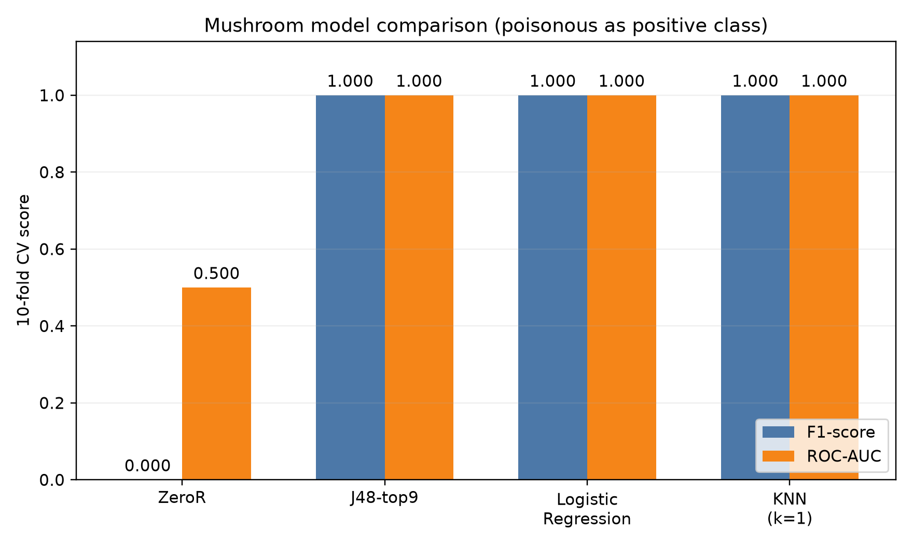

### 6.2 Mushroom：错误结构与最终选择

三种候选模型在 10 折汇总和 holdout 中均无 `FP` 或 `FN`。逻辑回归与 KNN 的 holdout 均为 TN=842、FP=0、FN=0、TP=783；J48-top9 的独立测试同样无错误，因此错误结构仍无法区分三者。

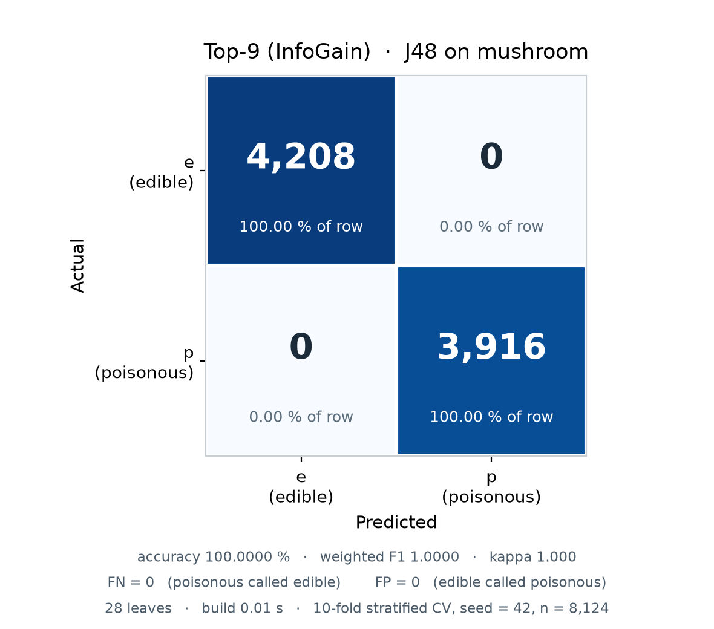

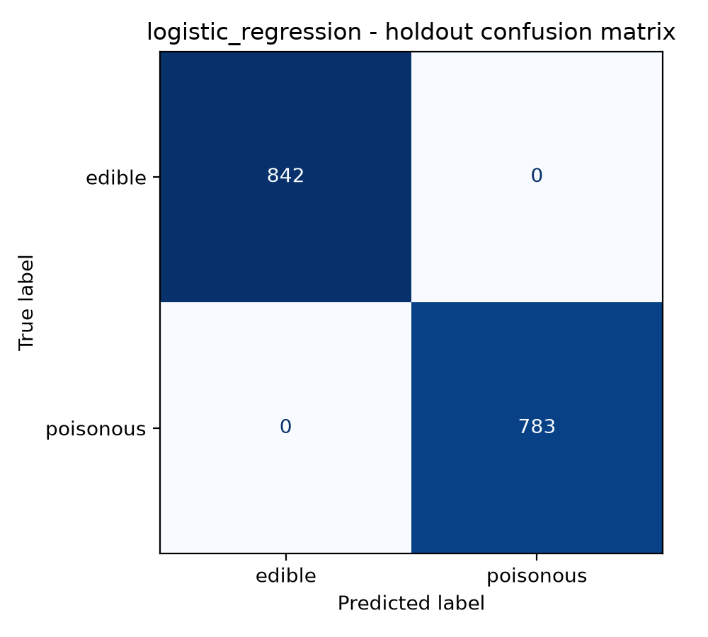

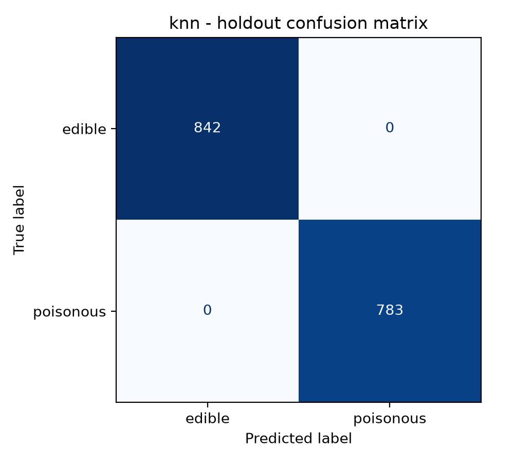

| 模型 | 结构 | 可解释性 | 主要成本 |
|---|---|---|---|
| J48-top9 | 9 属性、28 叶 | 高，规则直观 | 需要折内特征选择 |
| 逻辑回归 | 115 维线性加权 | 较高，可分析权重 | 管线直接，仅调节 `C` |
| KNN | 保存训练集并最近邻投票 | 中，可展示邻居 | 预测需计算距离 |

在性能与错误结构完全并列后，依据“更简单/更快”规则，**最终选择逻辑回归**。J48-top9 是最佳可解释替代；KNN 验证局部相似性有效，但无额外性能收益。

### 6.3 Mushroom：Apriori 结果

Apriori 得到 1568 个频繁项集和 104 条类别规则。

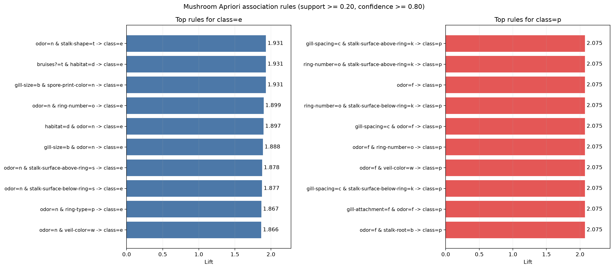

`odor=f → class=p` 的 Support=0.2659、Confidence=1.0000、Lift=2.0746；`odor=n → class=e` 的 Support=0.4195、Confidence=0.9660、Lift=1.8649。规则说明属性与类别的强共现关系，但不表示因果关系或现实食用建议。

### 6.4 Ionosphere：模型横向比较与最终选择

| 模型 | Accuracy | Precision | Recall | F1 | ROC-AUC |
|---|---:|---:|---:|---:|---:|
| 决策树 | 0.914 | 0.935 | 0.933 | 0.933 | 0.907 |
| RandomForest | 0.937 | 0.944 | 0.969 | 0.952 | 0.977 |
| 逻辑回归 | 0.883 | 0.879 | 0.960 | 0.914 | 0.897 |
| **RBF-SVM** | **0.943** | **0.946** | **0.982** | **0.956** | **0.980** |

RBF-SVM 在 F1 主指标上最高，因此首先成为当前最优模型；其 ROC-AUC 也最高，进一步支持该选择。其 Recall=0.982 同样为四者最高，说明对 good 类的漏检最少。因此无需进入“性能并列后比复杂度”的决胜步骤，**Ionosphere 最终选择 RBF-SVM**。

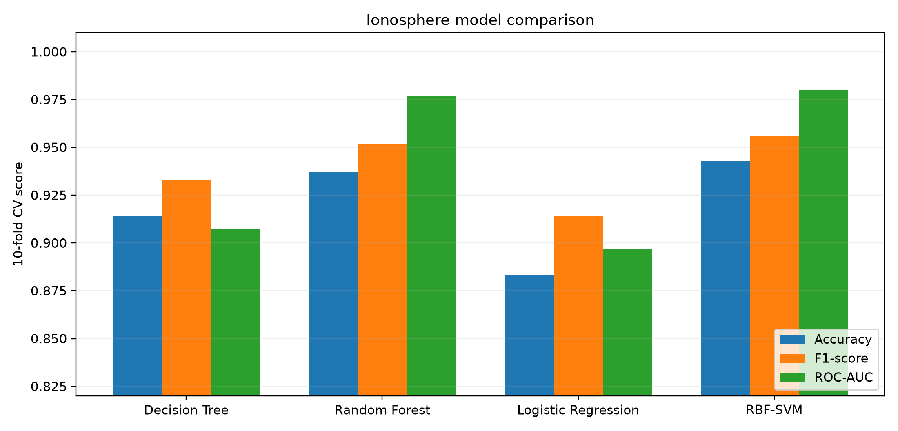

决策树可拟合非线性但单树稳定性有限；RandomForest 通过集成提高表现；逻辑回归受线性边界限制；RBF-SVM 的核边界与最大间隔机制更适配小样本数值数据。上述排名是交叉验证均值结果，不等同于统计显著性结论。

### 6.5 Ionosphere：KMeans 结果

全特征下 SSE 从 `k=1` 到 `k=2` 下降最明显，但肘部并不尖锐。标签辅助的特征探索中，仅取前 3 个特征时 purity 约 0.83；保留更多特征后 purity 下降，说明弱相关结构和噪声会影响距离计算。KMeans 可辅助观察数据结构与类别的关系，但不能替代监督分类。

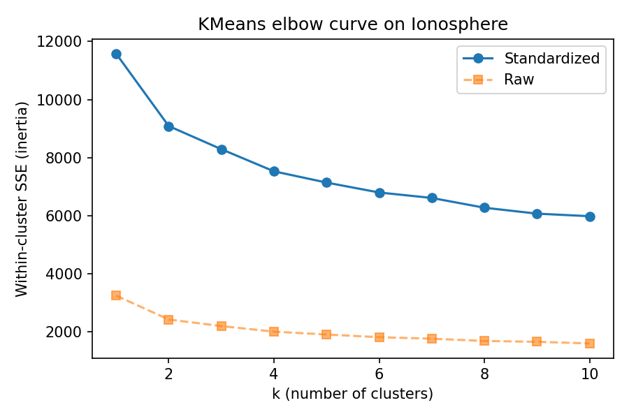

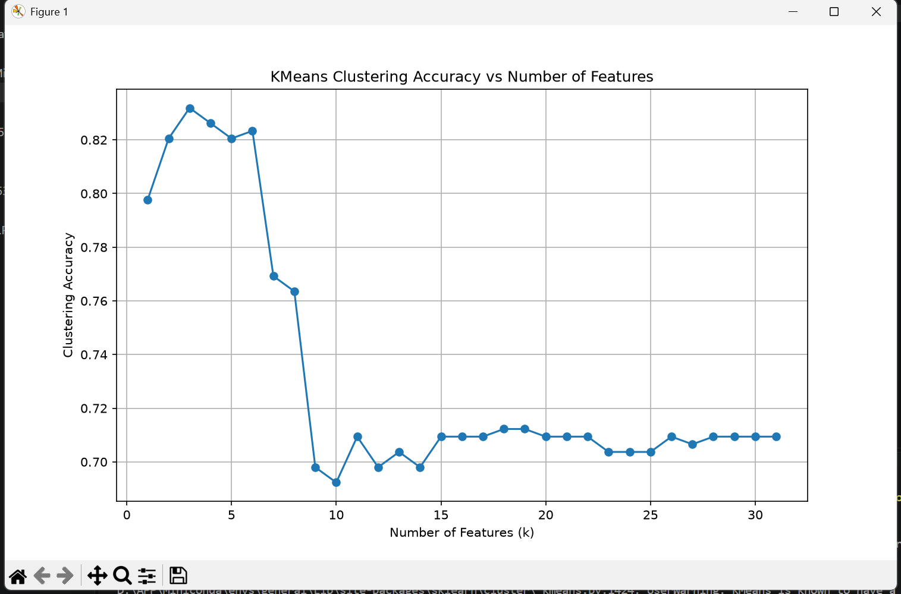

### 6.6 Cross-dataset Comparison

共同模型的结果显示明显的数据依赖性：

| 共同模型 | Mushroom F1 / ROC-AUC | Ionosphere F1 / ROC-AUC | 解释 |
|---|---|---|---|
| J48/决策树 | 1.000 / 1.000 | 0.933 / 0.907 | 名义属性的强规则容易分裂；小样本数值数据上的单树稳定性较弱 |
| 逻辑回归 | 1.000 / 1.000 | 0.914 / 0.897 | Mushroom 的线性加权已充分；Ionosphere 含更复杂的非线性边界 |

Mushroom 中增加 KNN 等候选并未超过简单线性模型，最终选择逻辑回归；Ionosphere 中 RBF-SVM 的非线性核边界取得最高 F1 和 ROC-AUC。由此回答“为什么模型在不同数据集上的优势不同”：**决定因素不是算法复杂度本身，而是归纳偏置是否与数据结构匹配。**

## 7 Conclusion and Future Work

本项目在统一协议下完成了两个 UCI 数据集的预处理、分类、无监督分析和模型择优。Mushroom 上多种模型满分，最终选择简单、稳定且可输出概率的逻辑回归；Ionosphere 上 RBF-SVM 以最高 F1 和 ROC-AUC 胜出。共同的 J48 与逻辑回归均在 Mushroom 上表现更强，说明名义属性的强类别信号比数值小样本中的复杂边界更容易学习。

无监督结果与分类任务互补：Apriori 发现气味等属性的强关联，KMeans 则显示自然簇与雷达标签并不完全重合。所有结果均为交叉验证均值和当前参数范围下的证据，不宣称统计显著性。Mushroom 为假设样本，结果不能外推为现实食用建议；Ionosphere 的多轮参数比较可能产生选择偏差，正式性能仍需独立测试或嵌套验证确认。

**研究问题回应汇总：**

| 研究问题 | 结论 |
|---|---|
| RQ1：共同模型的跨数据集表现 | J48 与逻辑回归均在 Mushroom 上满分，在 Ionosphere 上 F1 分别为 0.933 和 0.914；数据结构与归纳偏置的匹配决定了表现差异。 |
| RQ2：额外复杂度是否值得 | Mushroom 上无额外收益，选择逻辑回归；Ionosphere 上 RBF-SVM 以 F1=0.956、ROC-AUC=0.980 胜出，非线性复杂度有实际价值。 |
| RQ3：预处理的数据依赖性 | Mushroom 清洗未提高 J48 分数；Ionosphere 的标准化对树无效，而适当的属性选择、PCA 或 SelectKBest 能影响 SVM 表现。不存在对所有模型统一最优的预处理方案。 |
| RQ4：聚类能否替代监督分类 | 不能。KMeans 簇与真实标签仅部分对应，适合辅助探索结构，不适合作为本任务的监督分类替代品。 |

### 7.1 Future Work

- 在更多规模、噪声水平和类别不平衡的数据上验证模型选择结论。
- 研究概率校准、阈值调整和成本敏感评估，进一步区分类别排序与固定阈值表现。
- 对关联规则进行冗余过滤与外部验证，对聚类探索更有判别力的特征表示。

## References and Data Provenance

- Agrawal, R., & Srikant, R. (1994). Fast algorithms for mining association rules. *Proceedings of the 20th VLDB Conference*, 487–499.
- Admojo, F. T., Radhitya, M. L., Zein, H., & Naswin, A. (2024). Classification of mushroom edibility using K-Nearest Neighbors: A machine learning approach. *Indonesian Journal of Data and Science*, 5(3), 243–250. https://doi.org/10.56705/ijodas.v5i3.199
- Breiman, L. (2001). Random forests. *Machine Learning*, 45, 5–32. https://doi.org/10.1023/A:1010933404324
- Chawla, N. V., et al. (2002). SMOTE: Synthetic minority over-sampling technique. *Journal of Artificial Intelligence Research*, 16, 321–357. https://doi.org/10.1613/jair.953
- Dua, D., & Graff, C. (2019). *UCI Machine Learning Repository*. https://archive.ics.uci.edu/
- Duy, H. A., et al. (2023). An improved Apriori algorithm for interestingness of association rules: A case study on the Mushroom dataset. https://doi.org/10.1007/978-981-99-3091-3_20
- Frank, E., Hall, M. A., & Witten, I. H. (2016). *The WEKA Workbench: Online Appendix for Data Mining: Practical Machine Learning Tools and Techniques* (4th ed.).
- Pedregosa, F., et al. (2011). Scikit-learn: Machine learning in Python. *Journal of Machine Learning Research*, 12, 2825–2830.
- Quinlan, J. R. (1986). Induction of decision trees. *Machine Learning*, 1, 81–106. https://doi.org/10.1007/BF00116251
- Schlimmer, J. (1987). *Mushroom* [Dataset]. UCI Machine Learning Repository. https://doi.org/10.24432/C5959T （CC BY 4.0）
- Sigillito, V. G., Wing, S. P., Hutton, L. V., & Baker, K. B. (1989). Classification of radar returns from the ionosphere using neural networks. *Johns Hopkins APL Technical Digest*, 10(3), 262–266.
- Sigillito, V. G. (1988). *Ionosphere* [Dataset]. UCI Machine Learning Repository, ID 52. https://doi.org/10.24432/C5W01B （CC BY 4.0）
