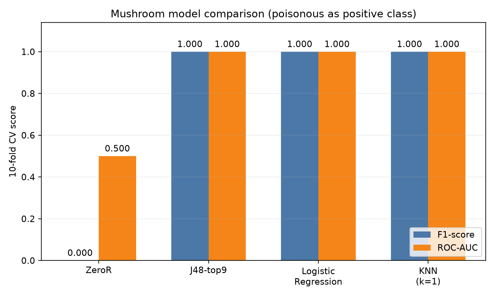

# Mushroom 模型对比与择优

## 1. 分类结果

以有毒类别 `p` 为正类，F1-score 为主指标，ROC-AUC 为次要指标。J48 采用五种方案中综合表现最好的 **J48-top9**。

| 模型 | 10 折 F1 | 10 折 ROC-AUC | Holdout F1 | 10 折有毒漏检数 |
|---|---:|---:|---:|---:|
| ZeroR | 0.0000 | 0.5000 | 未提供 | 3916 |
| **J48-top9** | **1.0000** | **1.0000** | **1.0000** | **0** |
| **逻辑回归** | **1.0000 ± 0.0000** | **1.0000 ± 0.0000** | **1.0000** | **0** |
| **KNN** | **1.0000 ± 0.0000** | **1.0000 ± 0.0000** | **1.0000** | **0** |

ZeroR 的 Accuracy 虽为 51.80%，但有毒类 F1 为 0，只能作为基线。其余三种模型均无漏检，性能并列，需依据复杂度择优。KNN 在 `k=1～9` 时均获满分，网格搜索按并列顺序记录 `k=1、weights='uniform'`，并非只有 `k=1` 最优。

## 2. 分类模型成本

| 模型 | 输入与结构 | 可解释性 | 主要成本 |
|---|---|---|---|
| J48-top9 | 9 个类别属性，28 个叶节点 | **高**：规则可直接展示 | 需要折内特征选择 |
| 逻辑回归 | 115 维 One-Hot，线性加权 | **较高**：可分析特征权重 | 管线直接，仅需调节 `C` |
| KNN | 保留训练集，最近邻投票 | **中**：可展示邻居，但无全局规则 | 预测需计算距离，扩展成本较高 |

按小组约定的 **F1 → ROC-AUC → 更简单/更快**规则，**最终推荐逻辑回归**：满分、管线简单、预测成本低，并能自然输出有毒概率。**J48-top9 是最佳可解释替代方案**；KNN 证明局部相似性同样有效，但没有带来额外收益。

## 3. Apriori 无监督关联分析

设置 Support≥0.20、Confidence≥0.80、最大项集长度 3，得到 **1568 个频繁项集、104 条类别关联规则**。

- `odor=f → class=p`：Support=0.2659，Confidence=1.0000，Lift=2.0746；
- `odor=n → class=e`：Support=0.4195，Confidence=0.9660，Lift=1.8649。

规则说明气味等属性与类别存在强共现关系，与分类模型的高表现相互印证；但关联不代表因果，不参与 F1 排名。详见 `../artifacts/a2_mushroom/apriori/results_summary.md`。

本结论仅适用于该 UCI 基准数据及当前协议。Weka 与 sklearn 的折索引并非完全相同，因此只比较汇总指标，不进行跨工具逐样本显著性判断。
