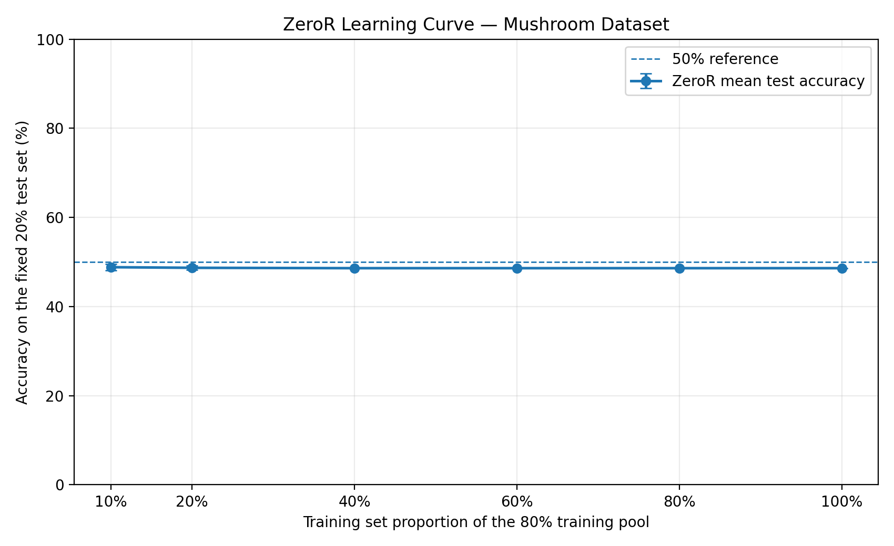
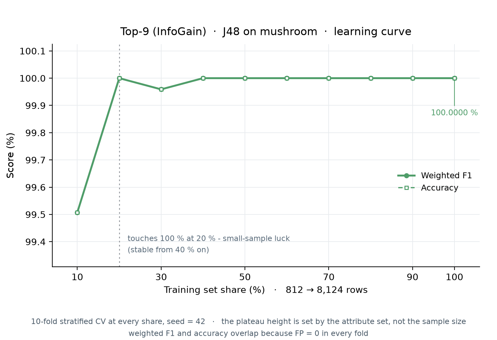
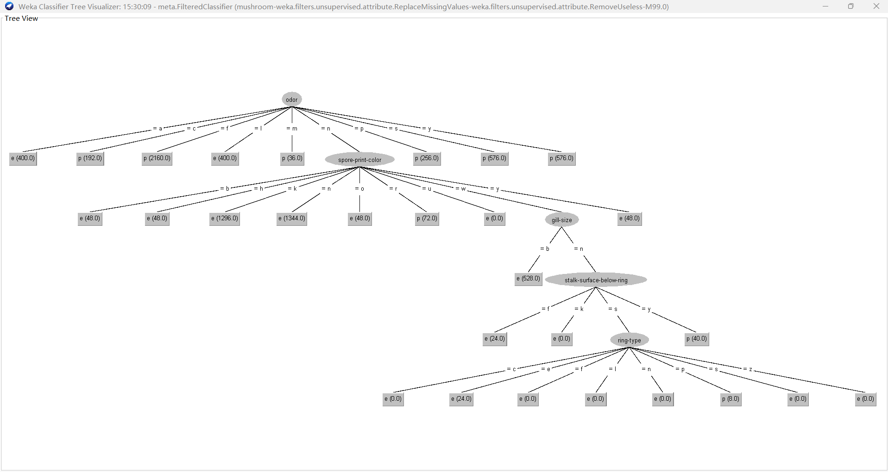
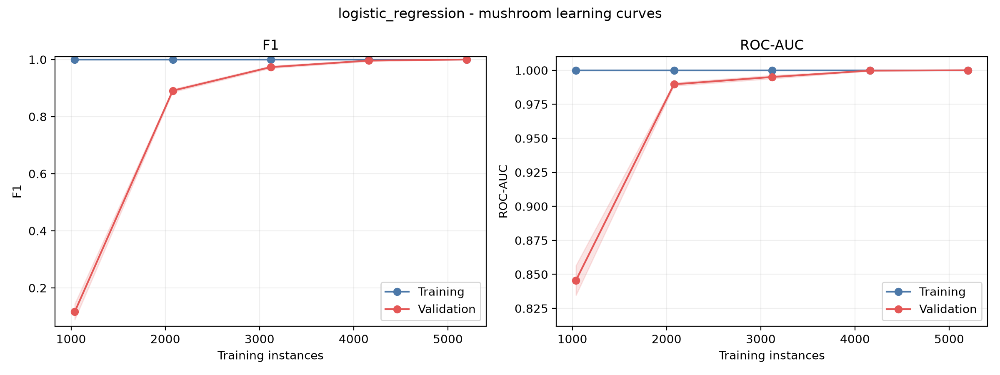
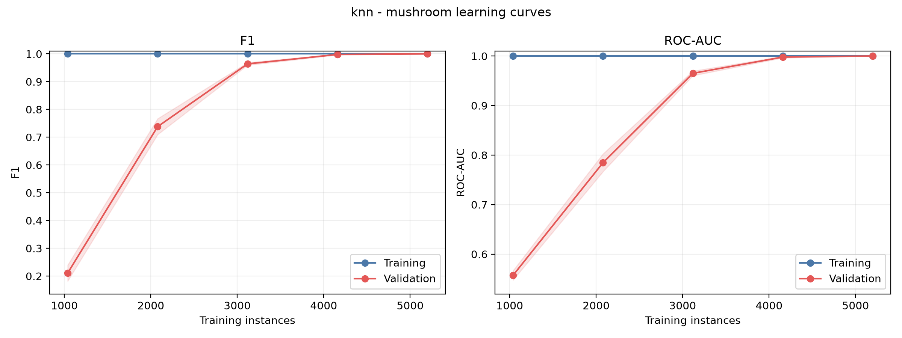
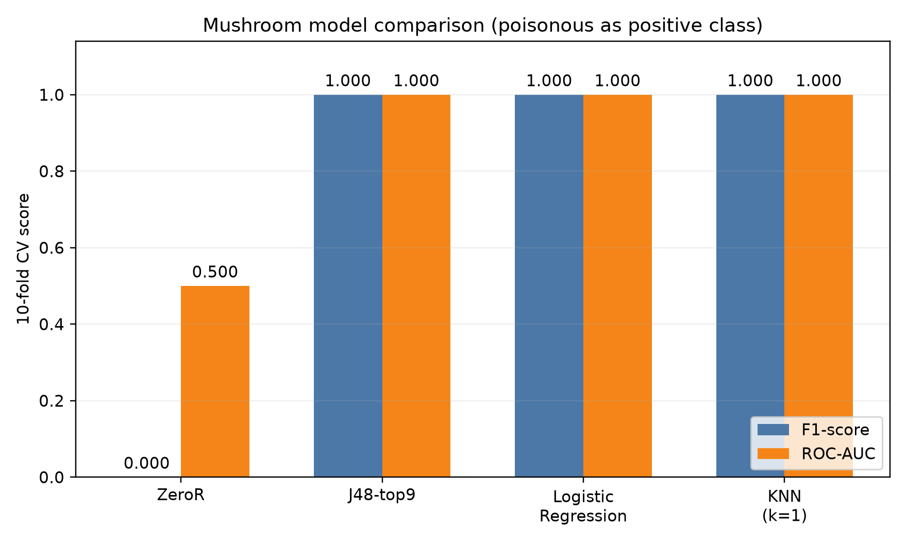
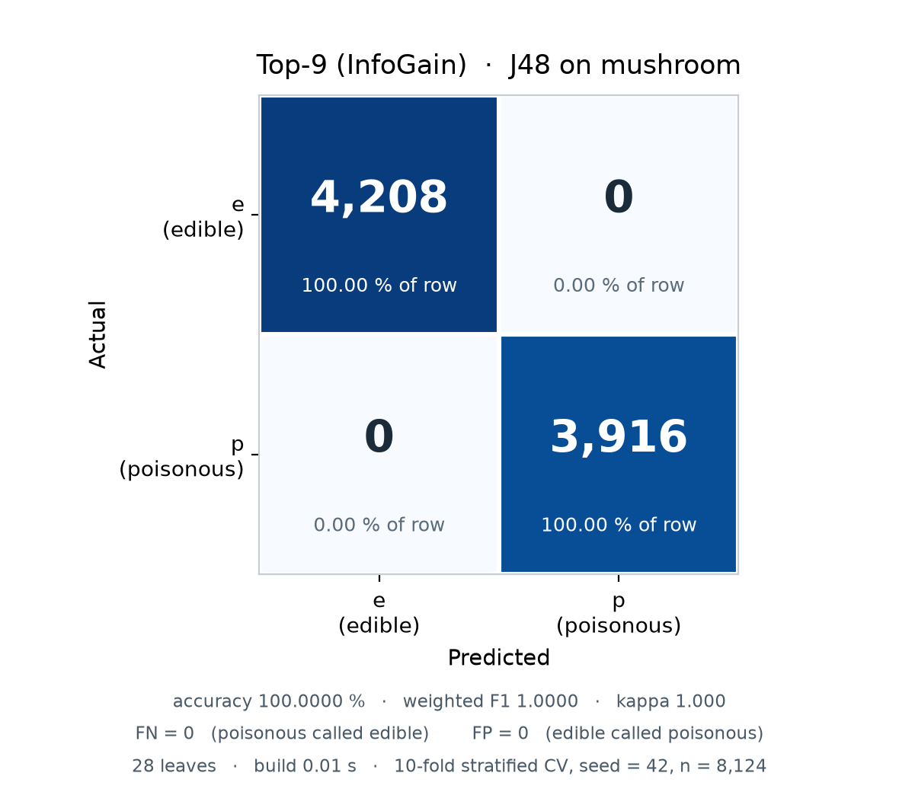
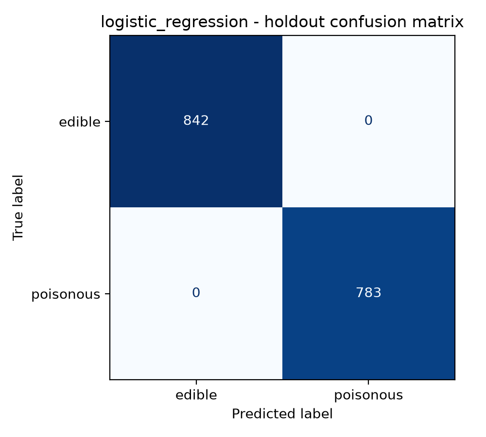
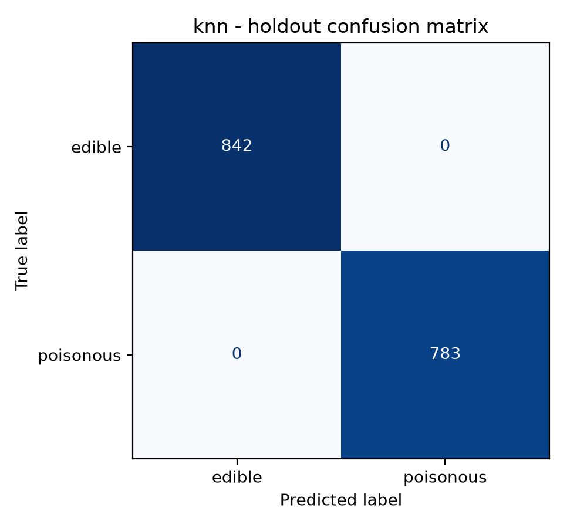
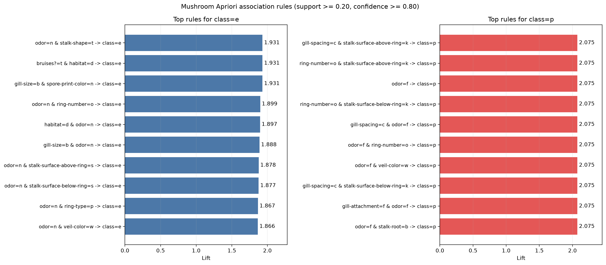

# Mushroom 数据集分析报告

## 1. 数据描述与通用预处理

Mushroom 数据包含 8124 条样本。原始数据有 22 个输入属性，均为名义属性；类别标签为可食（`e`）和有毒（`p`）。清洗后保留 21 个有效输入属性，其中可食 4208 条、有毒 3916 条，类别比例约为 51.80%:48.20%。

数据来自 UCI Machine Learning Repository 的 Mushroom 数据集，原始提供者为 Schlimmer（1987），DOI 为 [10.24432/C5959T](https://doi.org/10.24432/C5959T)，UCI 页面采用 CC BY 4.0 许可。

通用预处理按以下顺序执行：

1. **缺失值处理**：原始 `stalk-root` 含 2480 个缺失值，以该属性训练数据的众数填补，避免直接删除大量样本。
2. **无效属性处理**：`veil-type` 只有一个取值，不提供区分信息，因此删除。清洗后未发现完全重复样本。
3. **离群值处理**：所有输入均为名义属性，不存在连续变量意义上的 IQR 或 Z-score 离群值；不将低频类别误判为离群样本，也不据此删除样本。
4. **类别编码**：为需要数值输入的算法提供 One-Hot 表示，21 个属性展开为 115 个二元特征。实际编码器只在相应训练折拟合，避免预处理泄露。
5. **业务经验处理**：不依据未经来源验证的“蘑菇鉴别经验”删除属性或修改标签。属性保留与规则结论均由数据和后续实验检验；该数据为假设样本，不直接作为现实食用指南。

Weka 中依次使用 `ReplaceMissingValues` 和 `RemoveUseless -M 99.0` 完成上述清洗；输出关系名、属性清单和命令记录随实验文件保存，可直接复查。

预处理前后均使用 J48 做一致性检查，分类结果没有提升，说明这些操作的价值在于统一输入、处理缺失和移除无效属性，而非人为提高分数。

## 2. 模型训练

所有分类实验采用 `seed=42`、分层 10 折交叉验证，并以分层 80/20 切分作独立复核。训练折内完成相应编码、特征选择和调参，测试折不参与模型选择。统一以有毒类 `p` 为正类。

### 2.1 ZeroR：多数类基线

ZeroR 不使用输入属性，始终预测训练数据中的多数类 `e`。它用于判断其他模型是否真正学习了有效信息，不作为最终候选模型。

ZeroR 的曲线没有实质学习过程，只用于展示多数类基线随样本规模保持稳定。其 10 折中有毒类 F1 为 0，证明仅依靠类别比例不能完成有毒识别。

### 2.2 J48：从五种方案中确定唯一候选

J48 使用默认剪枝参数 `C=0.25、M=2`。模型构建阶段比较全属性、InfoGain top8/top9、CFS 和 Wrapper 五种方案，目的不是将五棵树全部送入最终比较，而是确定一种最有代表性的 J48 方案。

| 内部方案 | 输入属性数 | 10 折有毒漏检数 | 10 折 F1 | 建模成本/结构 |
|---|---:|---:|---:|---|
| all22 | 21 | 0 | 1.0000 | 25 个叶节点 |
| top8 | 8 | 8 | 0.9990 | 27 个叶节点 |
| **top9** | **9** | **0** | **1.0000** | **28 个叶节点** |
| CFS | 4 | 80 | 0.9898 | 17 个叶节点 |
| Wrapper | 5 | 0 | 1.0000 | 32 个叶节点，搜索成本更高 |

CFS 和 top8 出现有毒漏检，首先排除。all22、top9 和 Wrapper 均为满分；top9 比 all22 使用更少属性，又避免 Wrapper 的高成本搜索和更复杂树结构，因此**仅保留 J48-top9 作为后续横向比较的 J48 候选模型**。

J48-top9 的训练与验证表现随样本增加趋于一致，未显示明显的泛化缺口。这里的曲线用于观察样本规模与泛化关系，不表示逐批次 loss。

### 2.3 逻辑回归：线性候选模型

逻辑回归对训练折内的 115 维 One-Hot 特征进行加权，通过 Sigmoid 输出有毒概率，以 0.5 为分类阈值。采用 L2 正则、`lbfgs` 和 `max_iter=5000`，在训练部分用内层 5 折按 F1 搜索 `C=[0.01,0.1,1,10,100]`；holdout 训练部分选择 `C=10`。

训练分数始终较高，验证 F1 和 ROC-AUC 随样本增加上升，最终均达到 1.0。模型没有表现出明显的训练—验证差距，说明线性组合在该数据上已经充分。

### 2.4 KNN：局部相似性候选模型

KNN 使用训练折内 One-Hot 和 Euclidean 距离，以最近邻的已知类别进行投票。内层 5 折按 F1 搜索 `k=1～20` 和 `weights=['uniform','distance']`，ROC-AUC 使用邻居中的有毒类别比例。

`k=1～9` 的验证 F1 均为 1.0；网格搜索在并列时按搜索顺序记录 `k=1、weights='uniform'`。因此不能宣称只有 `k=1` 最优，只能说明较小的邻域已足以完成分类。

KNN 的验证分数随训练样本增加明显提高，最终达到满分。其训练分数在 `k=1` 时天然为 1，不能据此单独判断泛化能力，需结合验证曲线和交叉验证结果。

### 2.5 Apriori：无监督关联分析

Apriori 不训练标签预测模型，而是挖掘属性的共同出现规律。设置 Support≥0.20、Confidence≥0.80、最大项集长度 3，并筛选后件为 `class=e/p` 的规则。该分析使用全量数据进行描述性模式发现，不参与分类模型的 F1 排名。

## 3. 结果与横向评价

### 3.1 F1：排除无效基线，三种候选模型并列

| 模型 | 10 折有毒类 F1 | Holdout 有毒类 F1 |
|---|---:|---:|
| ZeroR | 0.0000 | 未提供 |
| **J48-top9** | **1.0000** | **1.0000** |
| **逻辑回归** | **1.0000 ± 0.0000** | **1.0000** |
| **KNN** | **1.0000 ± 0.0000** | **1.0000** |

ZeroR 的 Accuracy 虽为 51.80%，但有毒类 Recall 和 F1 均为 0，因此首先排除。其余三种模型的 F1 均为 1.0，**当前指标下三者并列最优**，无法仅根据 F1 继续排序。

### 3.2 ROC-AUC：仍然并列

| 模型 | 10 折 ROC-AUC | Holdout ROC-AUC |
|---|---:|---:|
| J48-top9 | 1.0000 | 1.0000 |
| 逻辑回归 | 1.0000 ± 0.0000 | 1.0000 |
| KNN | 1.0000 ± 0.0000 | 1.0000 |

三种模型均具有完整的类别排序能力，**ROC-AUC 指标下仍并列最优**。因此进入错误结构与模型成本比较。

### 3.3 错误结构：均无有毒漏检

三种候选模型在 10 折汇总和 holdout 中均为 `FN=0、FP=0`。逻辑回归与 KNN 的 holdout 混淆矩阵均为 TN=842、FP=0、FN=0、TP=783；J48-top9 的独立测试同样无错误。因此，安全性相关错误也无法区分三者。

### 3.4 复杂度与成本：确定最终模型

| 模型 | 结构 | 可解释性 | 主要成本 |
|---|---|---|---|
| J48-top9 | 9 个属性、28 个叶节点 | 高，规则直观 | 需要折内特征选择 |
| 逻辑回归 | 115 维线性加权 | 较高，可分析权重 | 管线直接，仅调节 `C` |
| KNN | 保存训练集，最近邻投票 | 中，可展示邻居 | 预测需计算距离，扩展成本较高 |

在 F1、ROC-AUC 和混淆矩阵均并列后，按照小组“更简单/更快”的规则，**最终选择逻辑回归**：它不需要特征选择，预测只需线性加权，并可自然输出有毒概率。J48-top9 保留为最佳可解释替代；KNN 证明局部相似性有效，但未带来额外收益。

### 3.5 Apriori 关联结果

Apriori 得到 1568 个频繁项集和 104 条类别关联规则。

`odor=f → class=p` 的 Support=0.2659、Confidence=1.0000、Lift=2.0746，说明恶臭气味与有毒类别存在强正相关。`odor=n → class=e` 的 Support=0.4195、Confidence=0.9660、Lift=1.8649，说明无气味样本主要与可食类别关联，但并非全部如此。这些共现规律与分类模型的高表现相互印证，但不构成因果关系或现实食用建议。

## 4. 小结与效度限制

Mushroom 上三种非基线分类模型均达到满分，最终差异来自复杂度和使用成本，而非预测分数。逻辑回归是综合最优模型，J48-top9 提供更直观的规则表达，KNN 验证了局部相似性方法，Apriori 则补充了属性与类别的关联证据。

Weka 与 sklearn 的相同随机种子不保证折索引完全一致，因此本文只比较汇总指标，不进行跨工具逐样本显著性判断。所有满分结论均限于该 UCI 基准数据及当前协议，不能外推为现实蘑菇鉴定的安全性保证。

## 5. 本部分参考文献

- Schlimmer, J. (1987). *Mushroom* [Dataset]. UCI Machine Learning Repository. https://doi.org/10.24432/C5959T
- Quinlan, J. R. (1986). Induction of decision trees. *Machine Learning*, 1, 81–106. https://doi.org/10.1007/BF00116251
- Frank, E., Hall, M. A., & Witten, I. H. (2016). *The WEKA Workbench: Online Appendix for Data Mining: Practical Machine Learning Tools and Techniques* (4th ed.).
- Pedregosa, F., et al. (2011). Scikit-learn: Machine learning in Python. *Journal of Machine Learning Research*, 12, 2825–2830.
- Admojo, F. T., Radhitya, M. L., Zein, H., & Naswin, A. (2024). Classification of mushroom edibility using K-Nearest Neighbors: A machine learning approach. *Indonesian Journal of Data and Science*, 5(3), 243–250. https://doi.org/10.56705/ijodas.v5i3.199
- Agrawal, R., & Srikant, R. (1994). Fast algorithms for mining association rules. *Proceedings of the 20th VLDB Conference*, 487–499.
- Duy, H. A., et al. (2023). An improved Apriori algorithm for interestingness of association rules: A case study on the Mushroom dataset. https://doi.org/10.1007/978-981-99-3091-3_20

# Ionosphere 数据集分析

> 以下仅保留另一数据集的内容位置，由对应负责人补齐；其数据、参数、结果和图表不在本 Mushroom 报告中虚构。

## 1. 数据描述与通用预处理

**[Ionosphere 占位：数据来源、许可、样本与属性统计、缺失/离群/编码及通用预处理]**

## 2. 模型训练

**[Ionosphere 占位：基线与各候选模型的选择理由、初始化/超参数、训练方式、学习曲线及模型内部筛选]**

## 3. 结果与横向评价

**[Ionosphere 占位：按 F1 → ROC-AUC → 错误结构 → 复杂度逐项横向比较并得出最优模型]**

## 4. 无监督分析与效度限制

**[Ionosphere 占位：无监督组件、结果解读、局限性与参考文献]**
