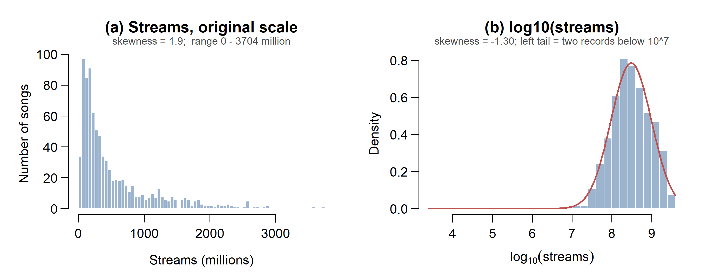
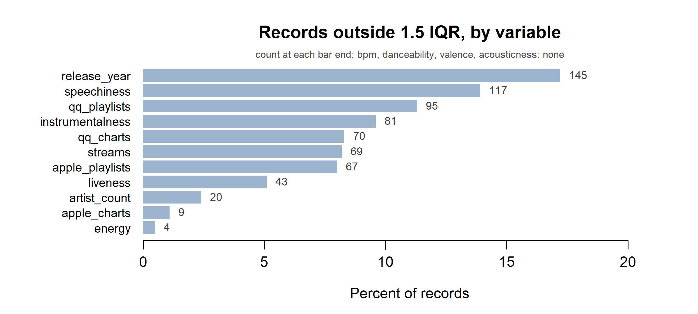
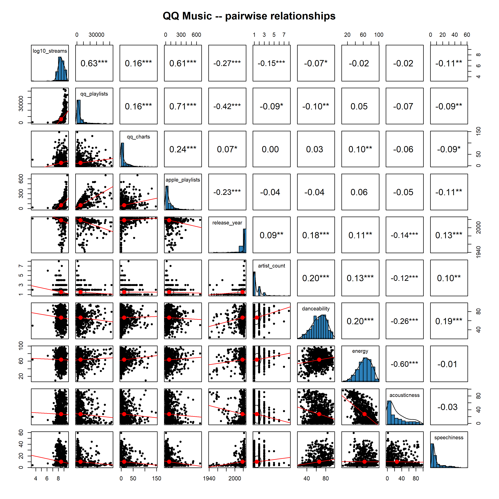
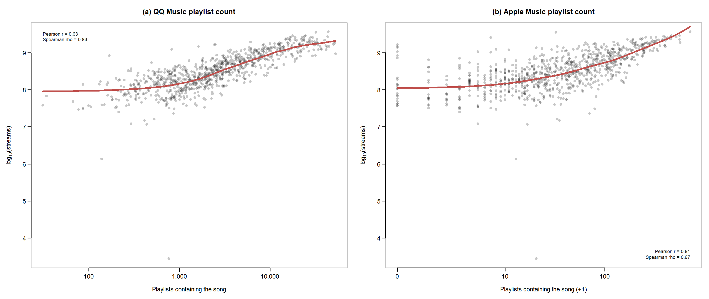
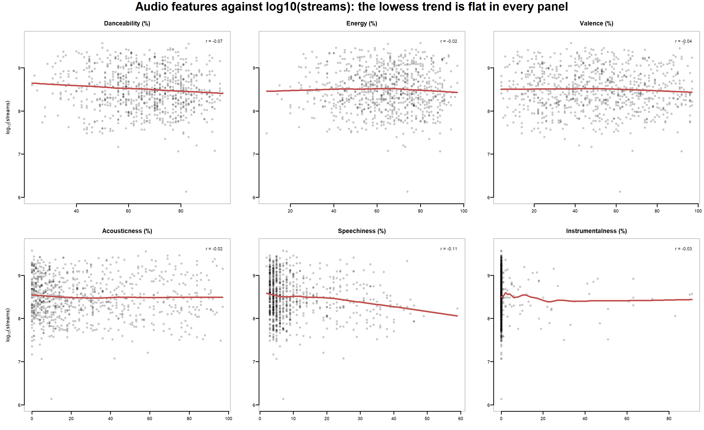
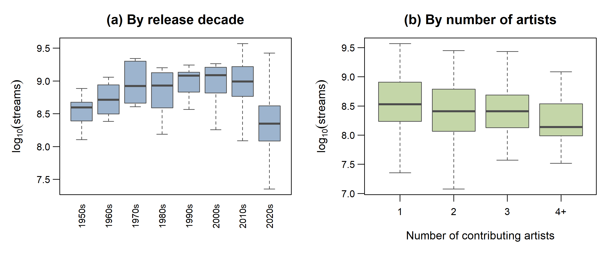
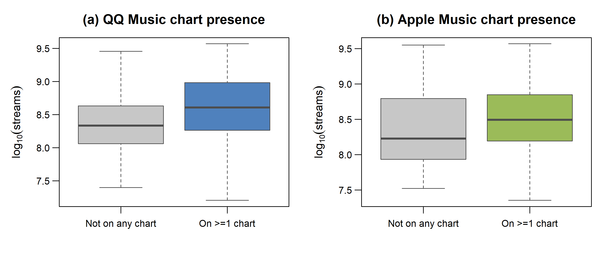

# Question 4, items 1 and 2 — EDA, research question and variable roles

**Haodong He (贺浩东)**, Student ID 3162500 — Role 4, Q4 EDA and research question lead

The report answers the question in the order the question asks it. Section 0 prepares the file, Item 1(a)
is the exploratory analysis and what it shows, Item 1(b) is the research question, and Item 2 gives every
variable its scale and role. The exploration itself follows the four-step workflow of the Week 4 lab, one
or two calls per step: `skim()`, then `create_report()`, then `dlookr`'s `diagnose()` and
`diagnose_outlier()`, then `pairs.panels()`. Seven figures and seven tables come out of the run, six of them written as CSV. The
model (item 3) is Ruiqi Gu's section, and the file it reads is described in Appendix A. `Q4_EDA.R` is
laid out in this same order — Section 0, then Item 1(a), 1(b) and 2 — so the script can be read beside
the report, and every number here comes from it and can be reproduced by running it.

| Marked requirement | Where it is answered |
|:---------------------------------|:----------------------------------------------------------|
| 1(a) Distributions and relationships, at least five plots, summary statistics, discussion of findings | Item 1(a), sub-sections (i)–(v): Figures 1–7 and Tables 3–6 |
| 1(b) One research question, its response and candidate predictors, relevance to the team, transformation justified | Item 1(b) |
| 2(a) Measurement scale, 2(b) independent or dependent role, 2(c) predictor or response role | Item 2, Table 7, one row per variable |
| Preparation, which the brief does not mark | Section 0 |

---

## 0. Data preparation, before item 1

The raw file has 844 rows and 21 columns, one row per song, combining an identifier, catalogue facts,
platform behaviour and audio features.

**Reviewing the columns against the Data Dictionary.** The dictionary sorts the 21 fields into four kinds:
an identifier (`track_name`, `artist(s)_name`, `artist_count`), catalogue facts (`released_year`,
`released_month`, `released_day`, `bpm`, `key`, `mode`), platform behaviour (`in_QQ_playlists`,
`in_QQ_charts`, `in_apple_playlists`, `in_apple_charts`, `streams`) and the seven `%` audio scores.
Checking each field against the data rather than against its label turned up three mismatches, and those
three set the agenda for the rest of this section. The four `in_*` columns are named like playlist and
chart membership but hold counts: 0 to 147 on `in_QQ_charts`, 0 to 275 on `in_apple_charts`, and 31 to
52,898 on `in_QQ_playlists`, so they are exposure measures rather than flags. `streams` is a play total in
every row but one, where a feature string sits in its place. `key` carries 11 levels rather than 12,
because missing is stored as an empty string. Table 1 keeps each dictionary name next to the name used
below.

The lab's preparation step covers type conversion and variable selection only, and that is the scope kept
here.

**Type conversion.** Fifteen column names are awkward inside a formula (brackets, a space, `%` signs),
so they are renamed once through a lookup table rather than by editing the file. Beyond renaming, three
columns are stored in a type that misleads. `mode` is a label, not a quantity, so it becomes a factor
with levels Major and Minor. `key` arrives as an empty string for missing rather than `NA`, which would
otherwise be read as a twelfth level. `qq_charts` is a count with 43.5% zeros, and its binary form
`charted_qq` is added because that is how it enters the model. `decade` and `artist_group` are created
for plotting: a boxplot of the 47 distinct release years is unreadable, and `artist_count` runs 1–8
with a long tail.

**Table 1. Raw column to analysis column.** Anyone reading the raw file next to this report needs it.

| Raw name | Analysis name | Raw name | Analysis name |
|:----------------------------|:--------------------|:----------------------------|:--------------------|
| `track_name` | `track_name` | `bpm` | `bpm` |
| `artist(s)_name` | `artist_name` | `key` | `key` |
| `artist_count` | `artist_count` | `mode` | `mode` |
| `released_year` | `release_year` | `danceability_%` | `danceability` |
| `released_month` | `release_month` | `valence_%` | `valence` |
| `released_day` | `release_day` | `energy_%` | `energy` |
| `in_QQ_playlists` | `qq_playlists` | `acousticness_%` | `acousticness` |
| `in_QQ_charts` | `qq_charts` | `instrumentalness_%` | `instrumentalness` |
| `streams` | `streams` | `liveness_%` | `liveness` |
| `in_apple_playlists` | `apple_playlists` | `speechiness_%` | `speechiness` |
| `in_apple_charts` | `apple_charts` | | |

**Variable selection.** Of the 21 columns, 16 become analysis variables and five are set aside.
`track_name` and `artist_name` label rows rather than measure anything — `artist_name` alone has 563
distinct values across 842 records, which would absorb almost every degree of freedom as a factor —
and `release_month`, `release_day` and `key` are kept in the file but carry nothing the question needs.
Of the sixteen, fourteen reach the model in item 3.

**Records that cannot be analysed.** Two rows leave the file. They are reached through three rules, and
neither of the two is a missing value that has been treated.

**Table 2. Records removed, with the reason for each.**

| Step | Rule | Rows affected | Rows left |
|:-------|:--------------------------------------------------|:--------------------|:-------------------|
| 0 | Raw file | — | 844 |
| 1 | Non-numeric `streams` set to missing | 1 | 844 |
| 2 | Duplicate on title + artist + streams removed | 1 | 843 |
| 3 | Missing response excluded | 1 | **842** |

Rule 1 is a field-shift error: one record (*Love Grows*, Edison Lighthouse) has the audio-feature string
`BPM110KeyAModeMajorDanceability53…` in the `streams` column. The stream total cannot be recovered from
it and its digits already sit in their own columns, so the value is set to missing rather than guessed.
Rule 2 removes one duplicate row, keyed on lowercase title, lowercase artist and stream total. *About Damn Time* (Lizzo) appears twice at 723,894,473 streams but with different playlist counts, and two genuine releases would not agree to the unit, so the second row is a copy rather than a separate record. Nine other
pairs share a title and are kept: six are different songs by different artists (for example *Daylight*
by David Kushner and by Harry Styles), and three share title and artist but carry different stream
totals (*SNAP*, *SPIT IN MY FACE!*, *Take My Breath*), which points to separate versions rather than a
copied row. Rule 3 drops the one record left without a response, since imputing the outcome would mean
inventing the variable being explained. The record of rule 1 is the record of rule 3: setting a value to
missing removes no row, so 844 − 2 = 842.

Following the lab, nothing is imputed, no outlier is deleted and no variable is standardised. `key`
stays missing for 89 records (10.6%), and the gap looks harmless: mean log10 streams is 8.482 where a
key is present and 8.523 where it is not, against a standard deviation of 0.508. The consistency checks
return zero violations throughout — streams positive, `bpm` inside 40–220, the seven scores inside
0–100, dates valid, platform counts non-negative, `mode` complete.

**Final sample: n = 842, 21 original columns plus 4 derived.**

---

## Item 1(a) — Distributions, relationships, and what they show [8 marks]

Seven figures and four tables, produced in four steps, one or two calls per step.

### 1(a)(i) Step 1 — `skim()`: structure, missingness and distributions

`skim(dat)` returns three blocks: a data summary, a per-variable summary, and a missingness report. The
data summary is 842 rows over 27 columns once the derived variables are counted: 21 numeric, factors
for `mode`, `decade` and `artist_group`, and three character columns, `track_name`, `artist_name` and
`key`. The same object is written to `tables/skim_summary.csv`, so nothing in this section is typed by
hand.

Missingness is simpler than the size of the file suggests. `complete_rate` is 1.000 for 26 of the 27
columns; the only incomplete variable is `key`, at 0.894. No row is missing more than one value, so
there is no pattern to diagnose and no case to delete beyond the two in Table 2.

The numeric block is reproduced in Table 3, in `skim()`'s own columns (mean, sd, p0, p25, p50, p75,
p100), plus skewness, which `skim()` does not report and the script computes for Item 1(a)(v). Table 3
keeps sixteen of the twenty-one numeric columns: every numeric original except `release_month` and
`release_day`, plus `log10_streams`. The three 0/1 derived variables are left out because a mean of a
dummy says nothing a proportion does not. `skim()` also draws a miniature histogram per
variable; Figure 1 is the same idea for the response at full size, which is the one distribution worth
looking at properly.

**Figure 1. The response, raw and logged.** Panel (a) is the original scale, panel (b) the log scale
with a normal curve for reference.

{width=6.2in}

**Table 3. Per-variable summary after preparation (n = 842).**

| Variable | Mean | SD | Median | Q1 | Q3 | Min | Max | Skewness |
|:---------------|-----------:|-----------:|-----------:|-----------:|-----------:|--------:|-------------|---------:|
| streams | 535,839,095 | 584,806,628 | 301,017,411 | 146,914,619 | 701,997,830 | 2,762 | 3,703,895,074 | 1.904 |
| log10(streams) | 8.486 | 0.508 | 8.479 | 8.167 | 8.846 | 3.44 | 9.57 | −1.298 |
| qq_playlists | 5,527 | 8,272 | 2,311 | 895 | 6,071 | 31 | 52,898 | 2.765 |
| qq_charts | 12.4 | 20.2 | 3 | 0 | 17 | 0 | 147 | 2.524 |
| apple_playlists | 69.3 | 88.1 | 35 | 13 | 91 | 0 | 672 | 2.442 |
| apple_charts | 53.4 | 51.7 | 40 | 8 | 88 | 0 | 275 | 1.018 |
| artist_count | 1.52 | 0.84 | 1 | 1 | 2 | 1 | 8 | 2.368 |
| release_year | 2018.0 | 11.1 | 2022 | 2020 | 2022 | 1942 | 2023 | −4.047 |
| bpm | 122.6 | 28.4 | 120 | 99 | 142 | 65 | 206 | 0.403 |
| danceability | 66.5 | 14.8 | 68 | 56 | 78 | 23 | 96 | −0.393 |
| valence | 50.3 | 23.6 | 50 | 31 | 68 | 4 | 97 | 0.067 |
| energy | 63.7 | 16.7 | 65 | 53 | 77 | 9 | 97 | −0.413 |
| acousticness | 27.0 | 26.3 | 17 | 5 | 43 | 0 | 97 | 0.949 |
| instrumentalness | 1.8 | 8.9 | 0 | 0 | 0 | 0 | 91 | 6.654 |
| liveness | 18.0 | 13.2 | 12 | 10 | 23 | 3 | 92 | 1.964 |
| speechiness | 10.1 | 9.8 | 6 | 4 | 11 | 2 | 59 | 1.895 |

Four rows shape what follows. Every platform count is right-skewed, most of them badly: the mean of
`qq_playlists` is 2.39 times its median, so a mean-based summary describes a typical song poorly.
`instrumentalness` is skewed only because 90.4% of its values are exactly zero, which is a spike rather
than a spread. `release_year` is left-skewed by construction, since 632 of 842 songs (75.1%) were
released in 2020 or later. And the audio scores are bounded 0–100 indices with no physical unit, while
`bpm` is the only audio variable that looks symmetric.

### 1(a)(ii) Step 2 — `create_report()`: the one-command index

`create_report(dat, y = "log10_streams", output_dir = "figures")` writes `figures/eda_report.html`: a
self-contained page of seven sections and twenty-three figures — bar charts for the categorical columns,
histograms and QQ plots for the numeric ones, a missingness profile, a correlation heatmap, a principal
component pair plot, and response-versus-predictor panels. The page's only table is the raw-count summary
that opens it; data structure is a typed list rather than a table.

It is used here as an index rather than as evidence. Every claim in the rest of Item 1(a) is tied to one
of the seven figures in this report or to a numbered table, because a page of automatically generated
plots cannot say why a variable behaves the way it does. What the HTML adds is coverage: it also plots
the columns this analysis drops, which is how the count-like behaviour of the two `in_*_charts` columns
was noticed in the first place.

### 1(a)(iii) Step 3 — `diagnose()`: data quality and the IQR rule

`dlookr` covers the step with one call per question: `diagnose(dat)` gives a row per variable with its
type, missing count and share, number of distinct values and their rate, and `diagnose_outlier(dat)`
returns the rows Table 4 is built from, flagging a record when it falls outside Q1 − 1.5·IQR or
Q3 + 1.5·IQR. As the lab's own note says, the function **reports** outliers; it does not remove them, and
no record is removed here.

`diagnose_outlier()` returns six columns; Table 4 keeps five of them and changes one. `outliers_ratio` is
divided by 100, because `dlookr` reports the share as a percent rather than a proportion, and the last
column is `without_mean`, the mean of the unflagged records. The package's own `with_mean` averages every
record, flagged ones included, so it says nothing about how far out the outliers sit, and it is dropped.

No column holds a negative or impossible value: `colSums(is.na(dat))` leaves `key` as the only
incomplete column, and the consistency checks of Section 0 returned zero violations, so nothing is
dropped on data-quality grounds either.

**Table 4. Records outside 1.5 IQR, by variable.** Raw numeric variables only: the four derived columns,
`release_month` and `release_day` are left out.

| Variable | Flagged | Share | Mean of flagged | Mean of the rest |
|:--------------------------------|---------:|------:|--------------------------:|--------------------------:|
| release_year | 145 | 17.2% | 2000.9 | 2021.6 |
| speechiness | 117 | 13.9% | 31.5 | 6.6 |
| qq_playlists | 95 | 11.3% | 25,281 | 3,015 |
| instrumentalness | 81 | 9.6% | 18.5 | 0.0 |
| qq_charts | 70 | 8.3% | 65.3 | 7.6 |
| streams | 69 | 8.2% | 2,054,000,000 | 400,325,000 |
| apple_playlists | 67 | 8.0% | 307.0 | 48.7 |
| liveness | 43 | 5.1% | 56.9 | 15.9 |
| artist_count | 20 | 2.4% | 4.8 | 1.4 |
| apple_charts | 9 | 1.1% | 233.7 | 51.5 |
| energy | 4 | 0.5% | 13.5 | 64.0 |
| bpm, danceability, valence, acousticness | 0 | 0% | — | — |

**Figure 2. Records flagged by the IQR rule, as a share of the sample.** The same numbers as Table 4,
drawn in base R.

{width=6.2in}

Two things follow, and the first is a decision not to act. The flagged records are not errors. The 69
songs outside the IQR on `streams` average 2.05 billion streams against 400 million for the rest; those
are the hits the question is about, and deleting them would leave a sample of mid-tier songs and answer
a different question. The same holds for `qq_playlists`, where the flagged group sits in 25,281
playlists on average. The heavy tail is the phenomenon rather than a defect in it, which is also why the
response is modelled on the log scale instead of being trimmed.

Second, where the flags fall follows the width of each column's middle half as much as its skewness. The
five columns closest to symmetry in Table 3 — `valence` 0.067, `danceability` −0.393, `bpm` 0.403,
`energy` −0.413, `acousticness` 0.949 — carry almost nothing: four are flagged zero times and `energy`
four times, 0.5%. The flags sit on the skewed columns, headed by `release_year` at 17.2%, `speechiness`
at 13.9% and `qq_playlists` at 11.3%. The order is not monotone in skewness — `speechiness` at 1.895
outranks `instrumentalness` at 6.654, and `acousticness` at 0.949 is clean while `energy` at −0.413 is
not — because a record is flagged only when it clears a fence built from that column's own quartiles.

Missingness gets one line rather than a figure, because a single incomplete column would draw a plot
with one bar: `key` alone is incomplete, at 89 records (10.6%), and Section 0 shows the gap is unrelated
to the response.

### 1(a)(iv) Step 4 — `pairs.panels()`

`pairs.panels(dat[panel])` draws the whole grid in one call, with the ten variables that carry the
question rather than all fourteen candidates.

**Figure 3. `pairs.panels()` grid of the ten variables that carry the question.** Histograms on the
diagonal, Pearson coefficients with significance stars above, scatter plots with a fitted line below.

{width=6.2in}

Across the top row, in the order the panel puts them: 0.63 for QQ playlists, 0.16 for QQ chart presence,
0.61 for Apple playlists, −0.27 for release year, −0.15 for artist count, and 0.11 at most in absolute
value for the four audio scores. Playlist exposure is the strongest companion of the response, release
timing is next, and content is flat. The lower triangles show the shapes behind those
numbers, which a coefficient cannot: the playlist relationship is convex in the raw scale, `release_year`
is bimodal with a cluster of recent releases, and `energy` against `acousticness` is a clear downward
cloud at −0.60.

The remaining figures take the parts of that grid the question needs at full size.

**Figure 4. Playlist exposure against streams.** Both axes log-scaled, the red line a lowess trend.

{width=6.2in}

**Figure 5. Audio features against log10(streams),** one panel each. The y axis starts at 6 so that a
single catalogue record at 3.44 does not flatten every panel.

{width=6.2in}

**Figure 6. Streams by release decade and by number of artists.** Panel (a) leaves out the two 1940s
records, which would be a group of two.

{width=6.2in}

**Figure 7. Streams by chart presence** on each platform.

{width=6.2in}

**Table 5. Association between each candidate predictor and log10(streams).**

| Predictor | Pearson r | Spearman ρ |
|:----------------------------------------|-------------------:|-------------------:|
| qq_playlists | 0.629 | 0.829 |
| apple_playlists | 0.610 | 0.668 |
| release_year | −0.270 | −0.682 |
| apple_charts | 0.264 | 0.335 |
| qq_charts | 0.159 | 0.270 |
| artist_count | −0.154 | −0.138 |
| speechiness | −0.108 | −0.122 |
| danceability | −0.072 | −0.090 |
| liveness | −0.050 | −0.063 |
| valence | −0.041 | −0.034 |
| instrumentalness | −0.026 | −0.004 |
| energy | −0.021 | −0.024 |
| acousticness | −0.020 | −0.052 |
| bpm | 0.010 | 0.010 |

Median streams are 215.9 million for songs on no QQ chart (n = 366) against 404.7 million for songs on
at least one (n = 476), and 338.5 million for solo records (n = 538) against 246.3 million for
collaborations (n = 304).

### 1(a)(v) What the seven figures and four tables show

**1. The response has to be logged.** Streams run from 2,762 to 3.70 billion, six orders of magnitude,
and on the raw scale the histogram is one bin wide (Figure 1a). On the log10 scale the distribution is
centred near 8.48, about 301 million streams, with an interquartile range of 8.167 to 8.846. The
skewness of −1.298 there comes from two records below 10⁷; the first percentile is already 7.475. The
transformation buys scale and interpretability, and it does not make the response normal, which matters
when the residuals are checked in item 3.

**2. Playlist exposure dominates, and the two correlations disagree usefully.** `qq_playlists` has
r = 0.629 but ρ = 0.829, so the relation is strongly monotone and not linear. Figure 4 shows why: the
lowess curve is steep mid-range and flattens at both ends. Entering the raw count as a linear term would
understate the effect there and overstate it at the extremes, so the predictor is logged too.

**3. The audio features carry almost nothing.** All seven scores have |r| ≤ 0.108 with the response and
every lowess curve in Figure 5 is flat; speechiness (−0.108) and danceability (−0.072) are the largest,
tempo is 0.010. On this catalogue, what a song sounds like says little about how much it is streamed.

**4. Release timing matters, and Pearson understates it.** r = −0.270 against ρ = −0.682. Median log10
streams rise from 8.60 for 1950s releases to 9.09 for 2000s releases, then fall to 8.35 for the 2020s,
which is 222.8 million against 945.4 million for everything earlier. Most of this is a stock-versus-flow
effect, since streams accumulate, so timing has to be controlled and the pattern must not be read as
older music being better.

**5. Chart presence goes with about double the streams on both platforms.** Songs on at least one QQ
chart (476, 56.5%) have a median of 404.7 million against 215.9 million, a ratio of 1.87; Apple gives
312.6 against 168.7 million, a ratio of 1.85. The two platforms agree on the size of the gap while
disagreeing on the split, since 89.4% of records are on an Apple chart and that comparison rests on 89
songs. The agreement is reassuring, and the different base rates are a second sign that the two
`in_*_charts` columns are counts on different scales.

**6. Collaborations stream slightly less.** 246.3 million against 338.5 million, with `artist_count`
correlating −0.154. The effect is weak and probably confounded with era, which is one reason to read
nothing in this section causally.

**7. Three predictor pairs are collinear.** `qq_playlists` with `apple_playlists` (0.712), `energy` with
`acousticness` (−0.595), `qq_charts` with `apple_charts` (0.555), visible in the Figure 3 grid and in
Table 6. Two of these are the same mechanism measured twice, so both members of a pair should not enter
a model. A correlation matrix cannot say which to drop, so that is left to Item 3(a) and Item 3(b).

**Table 6. Predictor pairs with |r| > 0.5** (the course screen; the VIF threshold is 5).

| Pair | r | Consequence |
|:----------------------|--------:|:--------------------------------------------------------------------|
| `qq_playlists` — `apple_playlists` | 0.712 | do not enter both; keep the QQ measure |
| `energy` — `acousticness` | −0.595 | may both stay, but coefficients are unstable |
| `qq_charts` — `apple_charts` | 0.555 | do not enter both; keep the QQ measure |

---

## Item 1(b) — Research question [part of the 8 marks for item 1]

Exposure varies a lot between songs and tracks streaming closely; audio content barely does. The
question compares those two blocks with the confounders held constant.

> How strongly is a song's streaming performance on QQ Music, measured as log10 streams, associated
> with the platform exposure it receives — how many QQ Music playlists it appears in and whether it
> appears on the QQ Music charts — compared with its audio characteristics (danceability, energy,
> valence, acousticness, speechiness, instrumentalness, tempo and mode), once release timing and the
> number of contributing artists are held constant?

A Gaussian GLM with an identity link on the log scale answers it, and the brief allows an `lm()` fit.

**Response.** The response is `log10(streams)`. Four things support the transformation: the raw variable
spans six orders of magnitude, so a one-unit change in a predictor cannot have a constant effect on it;
its histogram is a single bin (Figure 1a); its relation with the main predictor is curved on the raw
scale and near-linear on the log scale (Figure 4), so logging fixes functional form as well as scale;
and the logged variable is roughly symmetric apart from two records (median 8.479, IQR 8.167–8.846),
which is closer to what the Gaussian assumption needs. The justification is functional form and
interpretability rather than normality. The practical gain is that a coefficient becomes an approximate
proportional change: 0.10 means about 10% more streams, which a product team can act on. A binary
hit/not-hit outcome was considered and rejected for the main question, because it would discard three
quarters of the variation and needs an arbitrary cut-off that would then drive the answer. No threshold
is used in this part; a binary version appears in Item 3(e) only as a robustness check.

**Candidate predictors.**

| Block | Variables | Why it is in the question |
|---|---|---|
| Platform exposure | `qq_playlists`, `qq_charts` (as a 0/1 indicator) | The lever the QQ Music team controls, and the strongest bivariate association |
| Audio characteristics | `danceability`, `energy`, `valence`, `acousticness`, `speechiness`, `instrumentalness`, `bpm`, `mode` | The content-based alternative; weak individually, so they have to be judged jointly |
| Controls | `release_year`, `artist_count` | Both confound exposure: older songs have accumulated streams, collaborations cluster in recent years |

`liveness` is one of the seven audio scores and the only one left out of that block: at r = −0.050 it is
the weakest of them and would add a term without carrying signal, so it stays in the descriptive tables
and out of the model. `mode` and `bpm` stay because they describe the recording itself rather than a
listener's response to it.

`qq_charts` enters as an indicator because it is zero for 43.5% of songs, its non-zero values are
extremely skewed (mean 12.4, maximum 147), and a linear term in the count would be driven by a handful
of records. The indicator is also the stronger linear predictor, r = 0.217 against 0.159 for the count,
since the count is monotone (ρ = 0.270) but bends sharply near zero. `track_name` and `artist_name` are
identifiers with no analytical role. `apple_playlists` and `apple_charts` measure the same mechanism as
their QQ counterparts and correlate 0.712 and 0.555 with them, so both would add variance without adding
information about QQ Music. `release_month` and `release_day` have no plausible mechanism behind them.
`key` is missing for 10.6% of records, and with eleven unordered levels it carries much the same
information as `mode`, which is complete and therefore kept.

**Relevance to the QQ Music team.** The question separates two strategies with very different costs. If
exposure still dominates once audio content is controlled, editorial playlist placement and chart
seeding are the levers worth funding and content-based prediction has a low ceiling on this data. If the
audio features keep explanatory power once exposure is held constant, a content-based recommender or a
pre-release screening tool has a real role, since content is known before release and playlist placement
is not. The fitted model also gives an expected stream range for a given playlist count, which is what a
planner needs when deciding how much promotion a release deserves.

**Limitation.** Playlist placement is plausibly a consequence of popularity as well as a cause, since
editorial teams add songs that are already moving. Any coefficient on `qq_playlists` therefore measures
an association rather than the effect of adding a song to a playlist, and the data cannot separate the
two directions. That is why the findings above say "associated with" rather than "increases", and why
the conclusion in item 3 must not be written as a return on promotion.

---

## Item 2 — Variable roles [5 marks]

Table 7 gives every variable a measurement scale (2a), an independent/dependent role (2b) and a
predictor/response role (2c) relative to the question in Item 1(b). The last two columns answer
different questions and are not always the same: `release_year` is both an independent variable and a
predictor, whereas `decade` is a grouping made for one plot and is neither.

**Table 7. Variable roles in relation to the research question.**

| Variable | Measurement scale | IV / DV | Predictor / response | Treatment |
|:---------------------|:--------------------|:-------|:-----------------------|:----------------------------------|
| `track_name` | Nominal (identifier) | neither | identifier | not used |
| `artist_name` | Nominal (identifier) | neither | identifier | not used |
| `streams` | Ratio | DV | source of the response | transformed to `log10_streams` |
| `log10_streams` | Interval (derived) | DV | **response** | primary response |
| `qq_playlists` | Ratio (count) | IV | **predictor** | entered as log10 |
| `qq_charts` | Ratio (count, 43.5% zeros) | IV | **predictor** | entered as `charted_qq` |
| `charted_qq` | Nominal (binary, derived) | IV | **predictor** | 1 if `qq_charts` > 0 |
| `apple_playlists` | Ratio (count) | IV | excluded | collinear with `qq_playlists` (0.712) |
| `apple_charts` | Ratio (count) | IV | excluded | collinear with `qq_charts` (0.555) |
| `charted_apple` | Nominal (binary, derived) | IV | excluded | same reason |
| `artist_count` | Ratio (discrete, 1–8) | IV | **predictor** | control |
| `collab` | Nominal (binary, derived) | IV | alternative | 1 if `artist_count` > 1 |
| `release_year` | Interval | IV | **predictor** | control for stream accumulation |
| `release_month` | Ordinal (cyclical) | IV | excluded | no plausible mechanism |
| `release_day` | Interval (discrete) | IV | excluded | no plausible mechanism |
| `bpm` | Ratio | IV | **predictor** | audio characteristic |
| `mode` | Nominal (binary) | IV | **predictor** | audio characteristic |
| `danceability` | Interval (0–100) | IV | **predictor** | audio characteristic |
| `valence` | Interval (0–100) | IV | **predictor** | audio characteristic |
| `energy` | Interval (0–100) | IV | **predictor** | collinear with `acousticness` |
| `acousticness` | Interval (0–100) | IV | **predictor** | collinear with `energy` |
| `instrumentalness` | Interval (0–100) | IV | **predictor** | 90.4% zeros |
| `liveness` | Interval (0–100) | IV | considered, not entered | weakest score (−0.050) |
| `speechiness` | Interval (0–100) | IV | **predictor** | audio characteristic |
| `key` | Nominal (11 levels) | IV | excluded | missing for 89 records |
| `decade` | Ordinal (derived) | neither | descriptive | Figure 6a only |
| `artist_group` | Ordinal (derived) | neither | descriptive | Figure 6b only |

Three assignments need a word. `track_name` and `artist_name` are nominal but label rows rather than
measure anything, so they are neither predictor nor response, which the brief allows; `artist_name` is
not used even as a grouping factor because 563 distinct names across 842 records would absorb almost all
the degrees of freedom. The seven audio scores are interval and not ratio, being bounded 0–100 indices
from an audio-analysis service with no natural unit, so equal spacing is a property of the scoring
scale; `bpm`, `streams` and the platform counts have a true zero and a meaningful ratio, and
`release_year` looks like a count but has no meaningful zero. The derived variables change scale:
`log10_streams` is interval on the log scale, where equal differences are equal proportional differences
in streams, while `charted_qq` and `collab` collapse counts into nominal binaries, losing information but
removing the skew in Table 3. That trade is worth it for `charted_qq` only because the collapsed version
correlates more strongly. `release_month` is ordinal rather than interval: months are unequal in
length and the series is circular, so December sits beside January rather than at the end of a scale.
`decade` and `artist_group` are not predictors: they regroup `release_year` and `artist_count` for the
two panels of Figure 6.

---

## Appendix A — Handover to item 3

`data/QQ_Music_clean.csv`, 842 rows and 25 columns, written by `Q4_EDA.R`, should be the only input to
item 3. Anyone starting again from the raw file will silently include the field-shifted record and the
duplicate. Besides the 21 original columns the file adds four derived variables, defined identically for
both parts: `log10_streams` = log10(streams), `charted_qq` = 1 if `qq_charts` > 0, `charted_apple` = 1 if
`apple_charts` > 0, `collab` = 1 if `artist_count` > 1. `decade` and `artist_group` exist only inside the
script, for the two panels of Figure 6, which is why the file has 25 columns where the `skim()` of Item
1(a)(i) reports 27.

The preparation in one line: 844 → 842, with one field-shifted `streams` set to missing, one duplicate
row removed and one record without a response excluded; nothing imputed, no outlier deleted, nine
same-title pairs kept, `key` missing for 89 records. The question in one line: is log10 streams
associated more strongly with QQ Music exposure than with audio characteristics, once release timing and
artist count are held constant?

Items 1 and 2 estimate no model and report bivariate associations, group medians and data-quality
diagnostics only. The model specification, nested comparison, VIF, residual diagnostics, predicted
values with intervals and the conclusion are item 3.

---

## Appendix B — Files and how to run

| File | Contents |
|:------------------------------------------|:------------------------------------------------------------|
| `Q4_EDA.R` | items 1 and 2: prepares the file, runs the four EDA steps, writes the six result tables, the seven figures and `data/QQ_Music_clean.csv` |
| `Q4_GLM.R` | item 3, in the item 3 package: reads the cleaned file and writes its model tables and figures |
| `tables/column_map.csv` | Table 1, raw column to analysis column |
| `tables/records_removed.csv` | Table 2, the rows that leave the file and the three rules that reach them |
| `tables/skim_summary.csv` | the `skim()` object of Step 1, all 27 columns; Table 3 is sixteen rows of it plus a skewness column |
| `tables/iqr_outliers.csv` | Table 4, `diagnose_outlier()` with the share divided by 100 |
| `tables/association_with_response.csv` | Table 5, Pearson and Spearman against `log10_streams` |
| `tables/collinear_pairs.csv` | Table 6, predictor pairs above \|r\| = 0.5 |
| `figures/eda_report.html` | the `DataExplorer` report from Step 2 |
| `figures/` | the seven figures at 300 dpi |

Table 7 is the one table the script does not write: the measurement scale and the analytical role of
each variable are judgements, made once from the classes, levels and ranges that Item 2 prints.

Run `Q4_EDA.R` first; it is the only script that writes the analysis file. It is base R plus the four
packages the Week 4 lab installs — `skimr`, `DataExplorer`, `dlookr` and `psych` — on R 4.6.1;
`Q4_GLM.R` needs base R only.

One rendering note: attaching `dlookr` also attaches `showtext`, which draws text at 96 dpi; in a 300 dpi
PNG that makes every label about a third of its size. The two diagnostic plots are drawn first, with that
renderer, and `showtext::showtext_auto(FALSE)` then hands the pen back to the device for the seven
figures. `plot_outlier()` and `plot_na_pareto()` only run in an interactive session, so no figure here
depends on them.

The plotting code draws to a PNG device when the scripts are run non-interactively, which is how the
figures here were produced; sourced in RStudio it draws the same figures in the Plots pane instead. The
choice is the single `preview` line in each script. `create_report()` is the slowest line in the script,
about a minute, and it writes `figures/eda_report.html` in place; no number in this report depends on
it.
