CDS533 · Statistics for Data Science

# Assignment 3

Choosing Statistical Tests and Building Regression Models

## Division of Work

| Name | Student ID | Contribution |
|:-----|:-----------|:-------------|
| Gong Tinglu (公汀露) | To confirm | Q1: advertisement responses and rank-based testing. |
| Bei Xuecheng (贝学成) | To confirm | Q2: chick weights, ANOVA and diagnostic figures. |
| He Mingen (何铭恩) | To confirm | Q3: seven statistical studies and R analysis. |
| Haodong He (贺浩东) | 3162500 | Q4: data cleaning, exploratory analysis and variable roles. |
| Ruiqi Gu (顾瑞祺) | To confirm | Q4: model comparison, diagnostics and prediction. |
| Hu Shuaishuai (胡率帅) | To confirm | Assigned report integration; no separate handoff was available at the time of compilation. |

## Question 1: Choosing an Advertisement

*Choosing a test for an ordinal response measured on three independent groups*

Part A: Statistical Tests · Question 1 (10 marks: a = 4, b = 4, c = 2) · α = 0.05

### 1 (a) Response scale, groups, dependence structure and choice of test

**1.1 Response scale**

The response is an ordered reaction score, and the question states that a larger score indicates a more favourable response. The variable is therefore measured on an ordinal scale. Consumers can be ranked by favourability, but the numerical distance between scores is not known to be constant: a difference of one point need not represent the same change in favourability wherever it occurs on the scale, and a score of 90 is not twice as favourable as a score of 45. The mean and standard deviation are consequently convenient summaries rather than exact measurements of a population parameter, and inference that assumes the scores themselves are normally distributed is not well supported. A test based on ranks uses only the ordering of the observations, is unchanged by any strictly increasing transformation of the scores, and therefore matches the measurement level of the data.

**1.2 Number of groups and dependence structure**

The explanatory variable is advertisement with k = 3 levels (Red, White and Blue), so the study is a one-factor, three-level design. The groups are independent rather than paired: different randomly selected consumers viewed each advertisement, and each consumer viewed only one advertisement. No consumer therefore appears in more than one group, so there is no repeated measurement, no natural matching across advertisements and no block structure. The design is unbalanced, with n = 11 (Red), 13 (White) and 10 (Blue), giving N = 34 observations.

**1.3 Choice and justification of the test**

The Kruskal–Wallis rank-sum test is used. It is the rank-based analogue of the one-way analysis of variance, and it relaxes both the normality and the equal-variance requirements of the F-test. Three features of the study support the choice.

> • **(i) Ordinal response.** Because only the ordering of the scores is reliable, the ranks use exactly the information the scale carries. Ranking also removes the disproportionate influence of a single extreme score, which a mean-based test cannot do.
>
> • **(ii) Three independent groups.** The Wilcoxon rank-sum (Mann–Whitney) test compares only two groups. The Kruskal–Wallis test is its extension to k ≥ 3 groups and is the appropriate non-parametric method for this design.
>
> • **(iii) Normality is not credible and dispersion is unequal.** Each group contains only 10 to 13 observations, and the White group includes a score of 55 that produces a skewness of −1.090, against +0.623 for Red and +0.154 for Blue. Shapiro–Wilk tests do not reject normality (p = 0.232, 0.094 and 0.692), but at this sample size the test has very low power, so a non-significant result is not evidence that normality holds. Group variances differ by a factor of 2.948. A Brown–Forsythe (median-centred Levene) test does not reject equal variances (F = 0.293, df = 2 and 31, p = 0.748), yet a small, unbalanced design containing one outlying observation is precisely the setting in which the F-test is unreliable.

The conclusion does not depend on this choice: a one-way analysis of variance is reported in Section 2.5 as a cross-check and leads to the same decision. The rank test is nevertheless preferred because it is the method whose assumptions these data can actually support.

**1.4 Hypotheses**

Let *F<sub>R</sub>*, *F<sub>W</sub>* and *F<sub>B</sub>* denote the population distribution functions of the reaction score for consumers exposed to the Red, White and Blue advertisements respectively, and let *η<sub>R</sub>*, *η<sub>W</sub>* and *η<sub>B</sub>* denote the corresponding population medians. The hypotheses refer to all three groups at once.

> H*<sub>0</sub>***:** *F<sub>R</sub>* = *F<sub>W</sub>* = *F<sub>B</sub>*, equivalently *η<sub>R</sub>* = *η<sub>W</sub>* = *η<sub>B</sub>*. The three advertisements elicit reaction scores from populations with the same distribution; the advertisement shown has no effect on the reaction score.
>
> H*<sub>1</sub>***:** At least one of the three distributions differs in location from the others; the three population medians are not all equal.

The significance level is α = 0.05, with no direction of difference specified in advance. What H₁ asserts should be noted precisely. Because H₀ is a single statement about all three groups, rejecting it establishes only that the three distributions are not all identical; it does not assert that every pair of advertisements differs, nor does it identify which advertisement is responsible. This distinction governs the interpretation in part (c).

**2 (b) Descriptive statistics, graphical display and test result**

**2.1 Data handling**

All 34 supplied scores were analysed exactly as given. There are no missing values, no non-positive or out-of-range entries and no duplicated consumers, so no observation was excluded, imputed or modified. The low score of 55 in the White group is a genuine reaction from a real consumer and was retained: it is a legitimate part of the variation the study set out to measure. Group labels were stored as a factor ordered Red, White, Blue so that every table and figure follows the same order.

**Table 1.** Descriptive statistics for the reaction score by advertisement (N = 34).

| **Advertisement** | **n** | **Mean** | **SD** | **Median** | **Q1** | **Q3** | **IQR** | **Min** | **Max** |
|:---|:--:|:--:|:--:|:--:|:--:|:--:|:--:|:--:|:--:|
| Red | 11 | 81.818 | 8.716 | 80.0 | 76.500 | 84.500 | 8.000 | 71 | 98 |
| White | 13 | 84.846 | 11.539 | 87.0 | 79.000 | 92.000 | 13.000 | 55 | 99 |
| Blue | 10 | 74.500 | 6.721 | 74.0 | 69.250 | 80.000 | 10.750 | 65 | 85 |
| **All** | **34** | **80.824** | **10.128** | **80.5** | **75.000** | **86.750** | **11.750** | **55** | **99** |

*Scores are on an ordered scale, so the mean and SD are summaries only; variance and skewness appear in Table 2. Variance ratio (largest/smallest) = 2.948; SD ratio = 1.717.*

**2.2 Descriptive findings**

Two features of Table 1 and Figure 1 matter for the test and the recommendation. First, means and medians give the same ranking: White is highest on both (84.846 and 87.0), Blue lowest on both (74.500 and 74.0) and Red lies between (81.818 and 80.0). Since the median does not depend on the questionable spacing of an ordinal scale, the ordering is not an artefact of using means. Second, White is by far the most dispersed group: its standard deviation is 11.539 and its variance 133.141, about 2.95 times the variance of Blue, and its negative skewness of −1.090 comes from a single consumer who gave a score of 55, some 30 points below the White median. White therefore combines the best central reaction with the least consistent one. Red and White overlap heavily, with medians seven points apart but interquartile ranges of 8.000 and 13.000 and ranges overlapping from 71 to 98, so visual inspection alone cannot establish whether they differ.

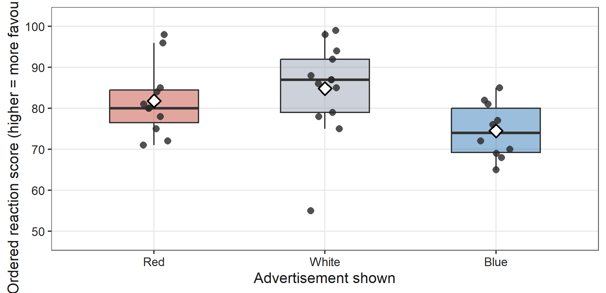

**Figure 1.** Reaction scores by advertisement. Boxes show the median and interquartile range, whiskers extend to the most extreme observations within 1.5 interquartile ranges, points are individual consumers (horizontally jittered) and the white diamond marks the group mean.

**2.3 Distributional diagnostics**

Figure 2 shows the distribution of scores within each advertisement, and Table 2 gives the numerical summaries on which the diagnostic reading rests. With only 10 to 13 observations per group a histogram can reveal gross features but cannot resolve moderate departures from normality, so the assessment combines Figure 2 with the skewness and Shapiro–Wilk results. The White distribution is the only one with a visible irregularity: a single isolated score of 55 produces its skewness of −1.090, while Red (+0.623) and Blue (+0.154) show no comparable feature. As Table 2 notes, the Shapiro–Wilk p-values must be read with care at this sample size, since a test with so few observations has little power to detect the departure that the skewness already indicates.

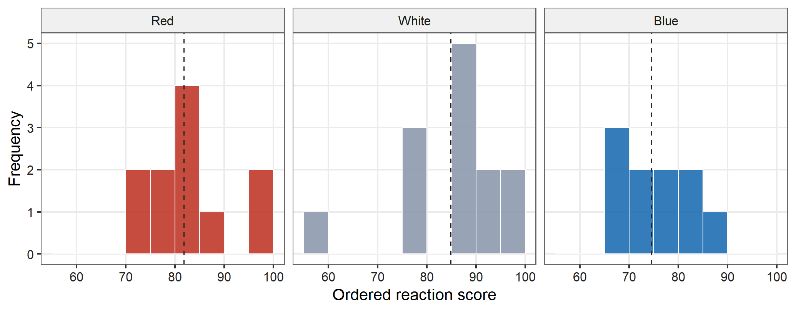

**Figure 2.** Distribution of reaction scores within each advertisement. Bins are five points wide and the dashed line marks the group mean; frequencies use separate scales because the group sizes differ.

**Table 2.** Normality and dispersion diagnostics by advertisement.

| **Advertisement** | **n** | **Variance** | **Skewness** | **Shapiro–Wilk p** | **Diagnostic reading** |
|:---|:--:|:--:|:--:|:--:|:---|
| Red | 11 | 75.964 | 0.623 | 0.232 | No evidence against normality, but low power |
| White | 13 | 133.141 | −1.090 | 0.094 | Closest to rejection; left-skewed, one extreme low score |
| Blue | 10 | 45.167 | 0.154 | 0.692 | No evidence against normality, but low power |

*Brown–Forsythe (median-centred Levene) test of equal variances: F = 0.293, df = 2 and 31, p = 0.748. With n = 10–13 the Shapiro–Wilk tests have very low power, so non-significant p-values are not evidence that normality holds.*

**2.4 Kruskal–Wallis test result**

All 34 observations were ranked from 1 to 34, tied scores receiving the average of the ranks they would otherwise have taken. Under H₀ the expected rank of any observation is (N + 1)/2 = 17.5, so the extent to which a group's mean rank departs from 17.5 drives the statistic. Table 3 shows that White has the highest mean rank (22.577) and Blue the lowest (10.600), while Red sits almost exactly at the null value (17.773).

**Table 3.** Rank sums and mean ranks by advertisement (N = 34, expected mean rank under H₀ = 17.5).

| **Advertisement** | **n**  | **Rank sum** | **Mean rank** | **Deviation from 17.5** |
|:------------------|:------:|:------------:|:-------------:|:-----------------------:|
| Red               |   11   |    195.5     |    17.773     |         +0.273          |
| White             |   13   |    293.5     |    22.577     |         +5.077          |
| Blue              |   10   |    106.0     |    10.600     |         −6.900          |
| **Total**         | **34** |  **595.0**   |  **17.500**   |            —            |

*Ties occur in the data (for example 85 appears three times, and 80, 72, 75, 78, 81, 87 and 98 twice each); kruskal.test() applies the tie correction automatically.*

The test statistic is H = 8.202 on df = k − 1 = 2, with p = 0.017, so H₀ is rejected at the 5% level (Table 4). Because a p-value says only whether a difference exists, the effect size is also reported: ε² = 0.249, an omnibus rank-based effect size, not a percentage of explained variation. By conventional benchmarks (0.01 small, 0.06 medium, 0.14 large) this is a medium to large effect, which indicates that the difference is substantial enough to be of practical interest, not merely large enough to be detected.

**Table 4.** Kruskal–Wallis rank-sum test of reaction score by advertisement.

| **Quantity**         | **Value**                    |
|:---------------------|:-----------------------------|
| Method               | Kruskal–Wallis rank-sum test |
| Test statistic H     | 8.202                        |
| Degrees of freedom   | 2                            |
| p-value              | **0.017**                    |
| Decision at α = 0.05 | **Reject H₀**                |
| Effect size ε²       | 0.249 (medium to large)      |

*ε² = H/\[(N² − 1)/(N + 1)\].*

**2.5 Sensitivity checks**

Because the Kruskal–Wallis p-value relies on a chi-square approximation and the groups are small, both statistics were also referred to permutation distributions obtained from 20,000 random reallocations of the 34 scores, using a fixed seed (Table 5). Every method reaches the same decision, so the conclusion does not depend on the approximation. The informative result is that the analysis of variance is the weaker of the two: the score of 55 both lowers the White mean and inflates the within-group variance, so it penalises the F statistic twice, whereas the rank test records it simply as the smallest observation. This is a concrete illustration of why the rank test suits these data.

**Table 5.** Comparison of tests and permutation-based p-values (20,000 permutations).

| **Method** | **Statistic** | **df** | **Asymptotic p** | **Permutation p** |
|:---|:--:|:--:|:--:|:--:|
| Kruskal–Wallis (primary) | H = 8.202 | 2 | **0.017** | **0.013** |
| One-way ANOVA (cross-check) | F = 3.483 | 2, 31 | 0.043 | 0.045 |

*Permutation p-values carry Monte Carlo error of roughly ±0.002. ANOVA sums of squares: advertisement 621.1 (MS 310.56), residuals 2763.8 (MS 89.16).*

**2.6 Contextual conclusion**

At the 5% level there is evidence that consumer reactions differ across the three advertisements (H = 8.202, df = 2, p = 0.017). The three populations of reaction scores are not identical, and the effect is of medium to large magnitude (ε² = 0.249). Descriptively, reactions were most favourable to White (mean 84.846, median 87, mean rank 22.577), intermediate for Red (81.818, 80, 17.773) and least favourable for Blue (74.500, 74, 10.600). The test establishes that not all three advertisements are equivalent; it does not establish which pairs differ.

**3 (c) Recommendation and what the overall test can and cannot establish**

**3.1 Recommendation**

White is the recommended advertisement, in the sense that the evidence supports it as the best of the three on average, not as a demonstrated improvement over Red in particular. Descriptively it has the highest mean (84.846), the highest median (87.0) and the highest mean rank (22.577 against an expected 17.5); inferentially the three advertisements are not equivalent (p = 0.017, ε² = 0.249), so the observed separation is not plausibly due to sampling variation alone. Blue should not be chosen: it has the lowest mean (74.500), the lowest median (74.0) and a mean rank of 10.600, some 6.9 ranks below the null expectation.

This recommendation must be qualified by the dispersion results. White also has the largest standard deviation (11.539) and variance (133.141), and one consumer reacted very poorly to it. If the studio wishes to maximise the average reaction, White is the better choice; if it wishes to avoid strongly negative reactions, Red is more defensible, since its standard deviation (8.716) and interquartile range (8.000) are both lower than White's. The data therefore support White as the first choice and Red as the conservative alternative.

**3.2 What the overall test can establish**

> • That the three advertisements are not all equivalent: at least one population of reaction scores differs in location from the others.
>
> • That the separation is unlikely to be a product of sampling variation, the probability of a statistic as large as H = 8.202 being about 1.7% under H₀, or 1.3% by permutation.
>
> • That the difference is large enough to matter, roughly a quarter of the rank variation being associated with the advertisement.
>
> • That the conclusion is robust, since the rank test, its permutation distribution and a parametric analysis of variance all reach the same decision.

**3.3 What the overall test cannot establish**

> **(i) It cannot identify which advertisements differ.** H₀ states that all three distributions are identical and H₁ only that they are not all identical. Rejection is therefore compatible with exactly one pair differing while the remaining pair is indistinguishable, and the test gives no indication of which comparison is responsible.
>
> **(ii) It cannot show that the advertisement with the highest sample mean is significantly better than the others.** The ordering of the sample means is a descriptive fact about these 34 consumers, not an inferential conclusion about the populations. In this dataset the point is not academic: the medians of Red and White differ by only seven points, their interquartile ranges are 8.000 and 13.000, and their ranges overlap from 71 to 98, so a difference between them cannot be inferred from the rejection alone.
>
> **(iii) It cannot rule out that the rejection is driven by a single group.** The observed pattern is consistent with a population ordering such as White ≈ Red \> Blue. Under that ordering H₀ is false and the test is correctly significant, yet White is not superior to Red; the statistic responds to departure from equality in any direction and is not a test of “White is best”.
>
> **(iv) It cannot quantify differences between particular pairs.** The effect ε² = 0.249 describes the overall separation of the three groups, not how much more favourable White is than Red, and no confidence interval for a pairwise difference follows from the omnibus test.

**3.4 What would be needed to identify particular pairs**

Identifying which advertisements differ requires follow-up pairwise comparisons, which the question does not ask for and which are therefore not performed here. Following a significant Kruskal–Wallis test the appropriate procedure is a rank-based multiple comparison, such as Dunn's or the Conover–Iman test, applied to the mean ranks in Table 3. Because there are three pairs, each comparison must be adjusted for multiplicity, for example by the Bonferroni rule (each test at α = 0.05/3 ≈ 0.0167) or by the Holm procedure; without adjustment the family-wise error rate across the three comparisons would be about 1 − 0.95³ ≈ 14% rather than the intended 5%. The defensible conclusion is therefore that the advertisements are not equivalent and that White is the best choice on the descriptive evidence, while an assertion that White is significantly better than Red remains untested.

**References**

Conover, W. J. (1999). Practical Nonparametric Statistics (3rd ed.). Wiley.

Kruskal, W. H., & Wallis, W. A. (1952). Use of ranks in one-criterion variance analysis. Journal of the American Statistical Association, 47(260), 583–621.

R Core Team (2024). R: A Language and Environment for Statistical Computing. R Foundation for Statistical Computing, Vienna, Austria. https://www.R-project.org/

Wickham, H. (2016). ggplot2: Elegant Graphics for Data Analysis (2nd ed.). Springer.

**Reproducibility**

Every number and figure in this section is produced by Q1_Choosing_an_Advertisement.R, which runs on base R, stats and ggplot2 and writes its figures to a figures/ sub-directory. The permutation p-values depend on random draws, so the script fixes set.seed(2026); the reported values (0.013 and 0.045) reproduce exactly from a clean session under R 4.3.3.

**Note on AI assistance.** In line with the course policy on permitted AI assistance, the authors acknowledge the use of an AI assistant for code checking and language editing here. All statistical choices, the analysis and its interpretation were reviewed and verified by the group.

## Question 2: Which Feed Helps Chicks Grow?

### (a) Hypotheses and assumptions

Let μ₁, …, μ₆ be the population mean six-week weights for the six feeds. H₀: μ₁ = ⋯ = μ₆; H₁: at least one mean differs. The question treats chicks as independent experimental units. The residual Q–Q plot is roughly linear, and residual spread is similar across feeds (largest/smallest group SD = 1.680). These checks support one-way ANOVA.

### (b) ANOVA in R

All 71 observations were used; none were missing or excluded.

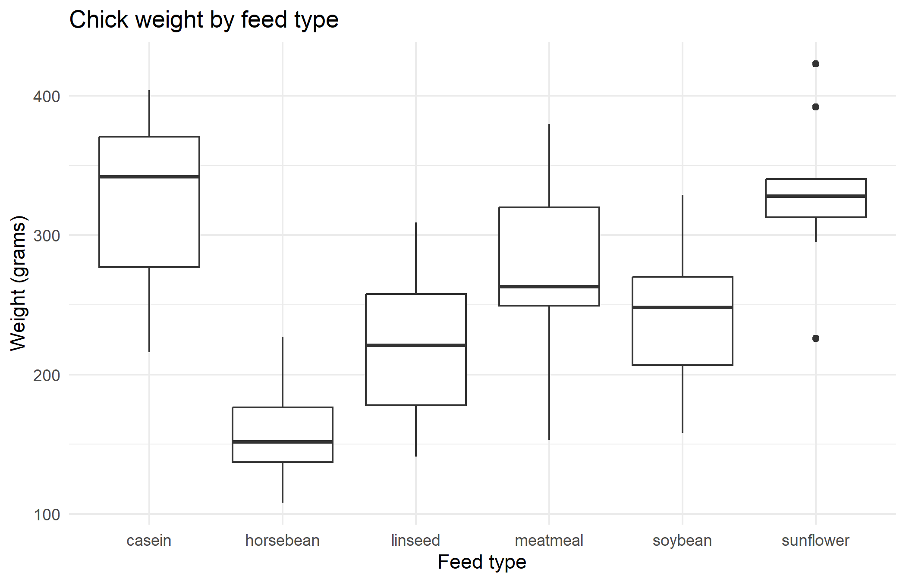

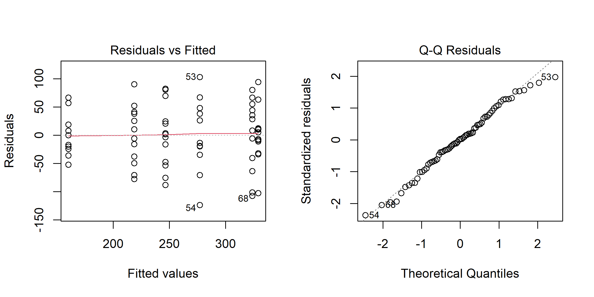

| Source | df | Sum of squares | Mean square | F | p |
|---|---:|---:|---:|---:|---:|
| Feed | 5 | 231129 | 46226 | 15.365 | < 0.001 |
| Residual | 65 | 195556 | 3009 | — | — |

Reject H₀ at α = 0.05: mean six-week weight differs for at least one pair of feeds.

### (c) Interpretation

A significant ANOVA does not show that every pair differs or that sunflower, which had the highest sample mean (328.917 g), is significantly better than the others. Tukey-adjusted comparisons would be needed to identify which feeds differ; they were not performed.

## Question 3: Seven Studies — Selecting Statistical Tests

**Course:** CDS533 Statistics for Data Science · Assignment 3

**Author:** HE Mingen (Student ID: 3162445) · Role: Question 3 lead

**Data source:**ISLR2 package (Hitters, College, Auto)

**Script:**R/q3.R (base R + ISLR2 + car)

This report answers Question 3 (30 points), which asks us to analyse seven independent studies using real datasets from the ISLR2 package. For each study we identify the design, choose and justify a test taught in the course, state the hypotheses, and report the statistic, degrees of freedom (where applicable), p-value, decision, and a contextual conclusion. The seven studies are separate research questions; no adjustment across them is required. Unless otherwise stated, α = 0.05 and results are reported to three decimal places, with p \< 0.001 written as "\< 0.001".

All numerical work is carried out in R (see the accompanying script R/q3.R). Each study below reproduces the exact R code used, followed by the resulting output.

### Study A — Is There a League Salary Gap?

#### Design

The response is the natural logarithm of 1987 annual salary (log salary), a continuous variable on a ratio scale. There are two independent groups — American League (A) and National League (N) — and different players belong to different leagues, so observations are independent. After removing players with missing or non-positive salaries, 263 players remain (139 American League, 124 National League).

#### Test choice and justification

We compare the population means of a continuous variable across two independent groups. The two-sample t-test is appropriate. Because the sample variances are close (0.897 vs 0.884), we report the Welch test, which does not assume equal variances and is robust.

#### Hypotheses

- H₀: μ_AL = μ_NL (equal population mean log salary across leagues)

- H₁: μ_AL ≠ μ_NL

#### Results

Descriptive statistics of log salary by league

| **Group**    | **n** | **Mean log salary** | **SD** |
|--------------|-------|---------------------|--------|
| American (A) | 139   | 5.933               | 0.897  |
| National (N) | 124   | 5.921               | 0.884  |

Welch two-sample t-test: **t = 0.104, df ≈ 258.43, p = 0.917**.

#### Decision and conclusion

At α = 0.05, we **fail to reject H₀**. There is no evidence that players in the American and National Leagues have different population mean log salaries. The observed difference in mean log salary (≈ 0.011) is small and within sampling variability.

### Study B — Tuition Versus Living Costs

#### Design

Each college contributes two paired measurements: log out-of-state tuition (log_tuition) and log room-and-board costs (log_living). Both are continuous ratio-scale variables measured on the same college, so the observations are paired (dependent). After filtering, n = 777 colleges are used.

#### Test choice and justification

We test whether the population mean difference between two paired continuous variables is zero. The paired t-test is appropriate because it accounts for the dependence within each college.

#### Hypotheses

- H₀: μ_d = 0, where d = log(Outstate) − log(Room.Board)

- H₁: μ_d ≠ 0

#### Results

Mean difference = 0.828, SD = 0.304. Paired t-test: **t = 75.774, df = 776, p \< 0.001**.

#### Decision and conclusion

At α = 0.05, we **reject H₀**. There is strong evidence that the population mean of log out-of-state tuition differs from that of log room-and-board costs. On average, out-of-state tuition is substantially larger: the mean log difference of 0.828 corresponds to tuition being roughly e^0.828 ≈ 2.3 times the room-and-board cost.

### Study C — Which Bill Is More Often Larger?

#### Design

A single-sample problem on a derived binary outcome. Among colleges where the two costs differ, we record whether out-of-state tuition exceeds room-and-board costs (767 of 777 colleges).

#### Test choice and justification

We test whether the probability that Outstate exceeds Room.Board equals one half. The sign test (a binomial test with p = 0.5) is appropriate: it assumes nothing about normality or symmetry of the cost distributions and uses only the sign of the difference.

#### Hypotheses

- H₀: P(Outstate \> Room.Board) = 0.5

- H₁: P(Outstate \> Room.Board) ≠ 0.5

#### Results

767 of 777 colleges have Outstate \> Room.Board (10 have Outstate \< Room.Board). Exact binomial test: **p \< 0.001**.

#### Decision and conclusion

At α = 0.05, we **reject H₀**. Among colleges where the two costs differ, out-of-state tuition exceeds room-and-board costs far more often than half the time.

**Comparison with Study B.** Study B tests whether the population *mean* of the log-transformed differences is zero — a test about the central location/magnitude. Study C tests only the *direction* — whether the probability of one cost exceeding the other is one half — ignoring magnitude. Both are strongly significant but answer different questions: B concerns the average size of the gap on the log scale, C concerns the sign of the gap. The results are consistent: tuition tends to exceed living costs both in average magnitude and in frequency of being the larger cost.

### Study D — American Versus Japanese Fuel Economy

#### Design

The response mpg is continuous and ratio-scale. We compare two independent groups — American (n = 245) and Japanese (n = 79) cars. No distributional assumption is imposed.

#### Test choice and justification

The question asks whether the *distributions* of mpg differ, not specifically the means. The Mann–Whitney U test (Wilcoxon rank-sum test) is appropriate: it detects rank differences without assuming normality, but is not a general test of all distributional differences. A pure location-shift interpretation requires similarly shaped distributions.

#### Hypotheses

- H₀: The distributions of mpg for American and Japanese cars are identical.

- H₁: The distributions of mpg differ (a location shift).

#### Results

Descriptive statistics of mpg by origin group

| **Group** | **n** | **Median mpg** | **Mean mpg** |
|-----------|-------|----------------|--------------|
| American  | 245   | 18.5           | 20.033       |
| Japanese  | 79    | 31.6           | 30.451       |

Mann–Whitney test: **W = 2456.5, p \< 0.001**.

#### Decision and conclusion

At α = 0.05, we **reject H₀**. There is strong evidence that the distribution of mpg differs between American and Japanese cars. Japanese cars tend to have substantially higher fuel economy (median ≈ 31.6 mpg) than American cars (median ≈ 18.5 mpg).

### Study E — Are Public and Private Colleges Equally Represented?

#### Design

A single-sample problem on one categorical variable (Private: Yes/No). We observe the frequencies of private and public colleges and compare them with a model assigning probability 0.5 to each category.

#### Test choice and justification

We test whether observed frequencies are consistent with an equal-probability (0.5/0.5) model. A chi-square goodness-of-fit test (or equivalently a binomial test on the proportion of private colleges) is appropriate. The equal-probability model is a hypothesis under test, not an established fact about US colleges.

#### Hypotheses

- H₀: P(Private = Yes) = 0.5 and P(Private = No) = 0.5

- H₁: the probabilities are not both 0.5

#### Results

565 private ("Yes") and 212 public ("No") colleges. Chi-square goodness-of-fit: **χ² = 160.372, df = 1, p \< 0.001** (binomial test: p \< 0.001).

#### Decision and conclusion

At α = 0.05, we **reject H₀**. The observed frequencies are not consistent with an equal-probability model: private colleges are far more common in this dataset than public colleges. The equal-probability model is rejected as a description of these data.

### Study F — Private Colleges and Incoming Student Profiles

#### Design

Two categorical variables are crossed: Private (Yes/No) and top10_group (High if Top10perc ≥ 50, otherwise Lower), summarised in a 2×2 contingency table. The threshold is fixed before the analysis.

#### Test choice and justification

We test whether the two categorical variables are associated. The chi-square test of independence is appropriate for a contingency table of counts.

#### Hypotheses

- H₀: Private-college status and having a High share of top-10% students are independent.

- H₁: They are associated.

#### Results

Contingency table: Private × top10_group

| **Private** | **High** | **Lower** |
|-------------|----------|-----------|
| No          | 14       | 198       |
| Yes         | 69       | 496       |

The proportion of "High" colleges is 12.2% among private colleges versus 6.6% among public colleges. Chi-square test of independence: **χ² = 5.083, df = 1, p = 0.024**.

#### Decision and conclusion

At α = 0.05, we **reject H₀**. There is evidence of an association: private colleges are more likely than public colleges to have a high share of incoming students from the top 10% of their high-school class (12.2% vs 6.6%).

**Difference from Study E.** Study E tests a single categorical variable (Private) against a fixed 0.5/0.5 model — a goodness-of-fit test in one dimension. Study F tests the *association between two* categorical variables (Private and top10_group) — a test of independence. They ask different questions: E asks "is the split of college type 50/50?", F asks "are college type and student profile related?".

**Why association ≠ causation.** An association does not demonstrate that being a private college *causes* a high top-10% share. The relationship may be driven by confounding factors — admissions selectivity, tuition, or applicant socioeconomic background — that correlate with both college type and student profile. Without an experiment or controls for confounding, the association is descriptive, not causal.

### Study G — Which Origin Has More Variable Fuel Economy?

#### Design

The response mpg is continuous. We compare its variability across three independent groups: American (n = 245), European (n = 68), and Japanese (n = 79) cars.

#### Test choice and justification

We test whether the population variance of mpg is the same across more than two groups, without requiring normality. Levene's test is appropriate: it compares spread across groups and is robust to non-normality. It is centred on group **medians** (the more robust option; car::leveneTest(..., center = median)).

#### Hypotheses

- H₀: σ²_American = σ²_European = σ²_Japanese (equal population variances)

- H₁: at least one group's variance differs

#### Results

Variance of mpg by origin group

| **Group** | **n** | **Variance** | **SD** |
|-----------|-------|--------------|--------|
| American  | 245   | 41.479       | 6.441  |
| European  | 68    | 43.299       | 6.580  |
| Japanese  | 79    | 37.089       | 6.090  |

Levene's test (median-centred): **F = 0.086, df = (2, 389), p = 0.918**.

#### Decision and conclusion

At α = 0.05, we **fail to reject H₀**. There is no evidence that the population variance of mpg differs across American, European, and Japanese cars. The observed sample variances are similar, and Levene's test provides no evidence against equal variability.

### Summary

Summary of all seven studies

| **Study** | **Question** | **Test** | **Statistic** | **p-value** | **Decision** |
|----|----|----|----|----|----|
| A | League salary gap | Welch two-sample t | t = 0.104, df ≈ 258 | 0.917 | Fail to reject |
| B | Tuition vs living costs | Paired t | t = 75.774, df = 776 | \< 0.001 | Reject |
| C | Which bill is larger | Sign (binomial) test | 767/777 | \< 0.001 | Reject |
| D | US vs Japan mpg distribution | Mann–Whitney U | W = 2456.5 | \< 0.001 | Reject |
| E | Public/private 50/50? | Chi-square GOF | χ² = 160.372, df = 1 | \< 0.001 | Reject |
| F | Private × top-10% association | Chi-square independence | χ² = 5.083, df = 1 | 0.024 | Reject |
| G | Equal mpg variance across origins | Levene (median) | F = 0.086, df = (2, 389) | 0.918 | Fail to reject |

## Question 4: What Makes a Hit? Exploring QQ Music

### Items 1 and 2 — EDA, research question and variable roles

**Haodong He (贺浩东)**, Student ID 3162500 — Role 4, Q4 EDA and research question lead

The report answers the question in the order the question asks it. Section 0 prepares the file, Item 1(a)
is the exploratory analysis and what it shows, Item 1(b) is the research question, and Item 2 gives every
variable its scale and role. The exploration itself follows the four-step workflow of the Week 4 lab, one
or two calls per step: `skim()`, then `create_report()`, then `dlookr`'s `diagnose()` and
`diagnose_outlier()`, then `pairs.panels()`. Seven figures and seven tables come out of the run, six of them written as CSV. The
model (item 3) is Ruiqi Gu's section, and the file it reads is described in Appendix A. `Q4_EDA.R` is
laid out in this same order — Section 0, then Item 1(a), 1(b) and 2 — so the script can be read beside
the report, and every number here comes from it and can be reproduced by running it.

| Marked requirement | Where it is answered |
|:---------------------------------|:----------------------------------------------------------|
| 1(a) Distributions and relationships, at least five plots, summary statistics, discussion of findings | Item 1(a), sub-sections (i)–(v): Figures 1–7 and Tables 3–6 |
| 1(b) One research question, its response and candidate predictors, relevance to the team, transformation justified | Item 1(b) |
| 2(a) Measurement scale, 2(b) independent or dependent role, 2(c) predictor or response role | Item 2, Table 7, one row per variable |
| Preparation, which the brief does not mark | Section 0 |

---

### 0. Data preparation, before item 1

The raw file has 844 rows and 21 columns, one row per song, combining an identifier, catalogue facts,
platform behaviour and audio features.

**Reviewing the columns against the Data Dictionary.** The dictionary sorts the 21 fields into four kinds:
an identifier (`track_name`, `artist(s)_name`, `artist_count`), catalogue facts (`released_year`,
`released_month`, `released_day`, `bpm`, `key`, `mode`), platform behaviour (`in_QQ_playlists`,
`in_QQ_charts`, `in_apple_playlists`, `in_apple_charts`, `streams`) and the seven `%` audio scores.
Checking each field against the data rather than against its label turned up three mismatches, and those
three set the agenda for the rest of this section. The four `in_*` columns are named like playlist and
chart membership but hold counts: 0 to 147 on `in_QQ_charts`, 0 to 275 on `in_apple_charts`, and 31 to
52,898 on `in_QQ_playlists`, so they are exposure measures rather than flags. `streams` is a play total in
every row but one, where a feature string sits in its place. `key` carries 11 levels rather than 12,
because missing is stored as an empty string. Table 1 keeps each dictionary name next to the name used
below.

The lab's preparation step covers type conversion and variable selection only, and that is the scope kept
here.

**Type conversion.** Fifteen column names are awkward inside a formula (brackets, a space, `%` signs),
so they are renamed once through a lookup table rather than by editing the file. Beyond renaming, three
columns are stored in a type that misleads. `mode` is a label, not a quantity, so it becomes a factor
with levels Major and Minor. `key` arrives as an empty string for missing rather than `NA`, which would
otherwise be read as a twelfth level. `qq_charts` is a count with 43.5% zeros, and its binary form
`charted_qq` is added because that is how it enters the model. `decade` and `artist_group` are created
for plotting: a boxplot of the 47 distinct release years is unreadable, and `artist_count` runs 1–8
with a long tail.

**Table 1. Raw column to analysis column.** Anyone reading the raw file next to this report needs it.

| Raw name | Analysis name | Raw name | Analysis name |
|:----------------------------|:--------------------|:----------------------------|:--------------------|
| `track_name` | `track_name` | `bpm` | `bpm` |
| `artist(s)_name` | `artist_name` | `key` | `key` |
| `artist_count` | `artist_count` | `mode` | `mode` |
| `released_year` | `release_year` | `danceability_%` | `danceability` |
| `released_month` | `release_month` | `valence_%` | `valence` |
| `released_day` | `release_day` | `energy_%` | `energy` |
| `in_QQ_playlists` | `qq_playlists` | `acousticness_%` | `acousticness` |
| `in_QQ_charts` | `qq_charts` | `instrumentalness_%` | `instrumentalness` |
| `streams` | `streams` | `liveness_%` | `liveness` |
| `in_apple_playlists` | `apple_playlists` | `speechiness_%` | `speechiness` |
| `in_apple_charts` | `apple_charts` | | |

**Variable selection.** Of the 21 columns, 16 become analysis variables and five are set aside.
`track_name` and `artist_name` label rows rather than measure anything — `artist_name` alone has 563
distinct values across 842 records, which would absorb almost every degree of freedom as a factor —
and `release_month`, `release_day` and `key` are kept in the file but carry nothing the question needs.
Of the sixteen, fourteen reach the model in item 3.

**Records that cannot be analysed.** Two rows leave the file. They are reached through three rules, and
neither of the two is a missing value that has been treated.

**Table 2. Records removed, with the reason for each.**

| Step | Rule | Rows affected | Rows left |
|:-------|:--------------------------------------------------|:--------------------|:-------------------|
| 0 | Raw file | — | 844 |
| 1 | Non-numeric `streams` set to missing | 1 | 844 |
| 2 | Duplicate on title + artist + streams removed | 1 | 843 |
| 3 | Missing response excluded | 1 | **842** |

Rule 1 is a field-shift error: one record (*Love Grows*, Edison Lighthouse) has the audio-feature string
`BPM110KeyAModeMajorDanceability53…` in the `streams` column. The stream total cannot be recovered from
it and its digits already sit in their own columns, so the value is set to missing rather than guessed.
Rule 2 removes one duplicate row, keyed on lowercase title, lowercase artist and stream total. *About Damn Time* (Lizzo) appears twice at 723,894,473 streams but with different playlist counts, and two genuine releases would not agree to the unit, so the second row is a copy rather than a separate record. Nine other
pairs share a title and are kept: six are different songs by different artists (for example *Daylight*
by David Kushner and by Harry Styles), and three share title and artist but carry different stream
totals (*SNAP*, *SPIT IN MY FACE!*, *Take My Breath*), which points to separate versions rather than a
copied row. Rule 3 drops the one record left without a response, since imputing the outcome would mean
inventing the variable being explained. The record of rule 1 is the record of rule 3: setting a value to
missing removes no row, so 844 − 2 = 842.

Following the lab, nothing is imputed, no outlier is deleted and no variable is standardised. `key`
stays missing for 89 records (10.6%), and the gap looks harmless: mean log10 streams is 8.482 where a
key is present and 8.523 where it is not, against a standard deviation of 0.508. The consistency checks
return zero violations throughout — streams positive, `bpm` inside 40–220, the seven scores inside
0–100, dates valid, platform counts non-negative, `mode` complete.

**Final sample: n = 842, 21 original columns plus 4 derived.**

---

### Item 1(a) — Distributions, relationships, and what they show [8 marks]

Seven figures and four tables, produced in four steps, one or two calls per step.

#### 1(a)(i) Step 1 — `skim()`: structure, missingness and distributions

`skim(dat)` returns three blocks: a data summary, a per-variable summary, and a missingness report. The
data summary is 842 rows over 27 columns once the derived variables are counted: 21 numeric, factors
for `mode`, `decade` and `artist_group`, and three character columns, `track_name`, `artist_name` and
`key`. The same object is written to `tables/skim_summary.csv`, so nothing in this section is typed by
hand.

Missingness is simpler than the size of the file suggests. `complete_rate` is 1.000 for 26 of the 27
columns; the only incomplete variable is `key`, at 0.894. No row is missing more than one value, so
there is no pattern to diagnose and no case to delete beyond the two in Table 2.

The numeric block is reproduced in Table 3, in `skim()`'s own columns (mean, sd, p0, p25, p50, p75,
p100), plus skewness, which `skim()` does not report and the script computes for Item 1(a)(v). Table 3
keeps sixteen of the twenty-one numeric columns: every numeric original except `release_month` and
`release_day`, plus `log10_streams`. The three 0/1 derived variables are left out because a mean of a
dummy says nothing a proportion does not. `skim()` also draws a miniature histogram per
variable; Figure 1 is the same idea for the response at full size, which is the one distribution worth
looking at properly.

**Figure 1. The response, raw and logged.** Panel (a) is the original scale, panel (b) the log scale
with a normal curve for reference.

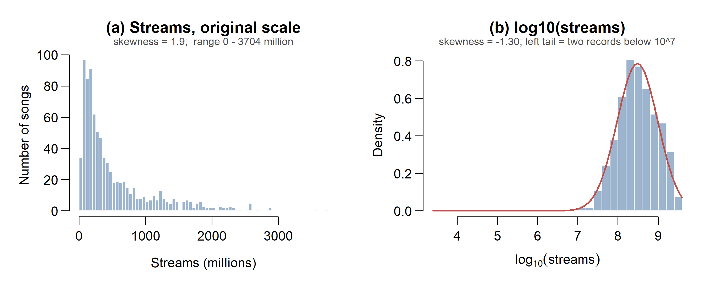

**Table 3. Per-variable summary after preparation (n = 842).**

| Variable | Mean | SD | Median | Q1 | Q3 | Min | Max | Skewness |
|:---------------|-----------:|-----------:|-----------:|-----------:|-----------:|--------:|-------------|---------:|
| streams | 535,839,095 | 584,806,628 | 301,017,411 | 146,914,619 | 701,997,830 | 2,762 | 3,703,895,074 | 1.904 |
| log10(streams) | 8.486 | 0.508 | 8.479 | 8.167 | 8.846 | 3.44 | 9.57 | −1.298 |
| qq_playlists | 5,527 | 8,272 | 2,311 | 895 | 6,071 | 31 | 52,898 | 2.765 |
| qq_charts | 12.4 | 20.2 | 3 | 0 | 17 | 0 | 147 | 2.524 |
| apple_playlists | 69.3 | 88.1 | 35 | 13 | 91 | 0 | 672 | 2.442 |
| apple_charts | 53.4 | 51.7 | 40 | 8 | 88 | 0 | 275 | 1.018 |
| artist_count | 1.52 | 0.84 | 1 | 1 | 2 | 1 | 8 | 2.368 |
| release_year | 2018.0 | 11.1 | 2022 | 2020 | 2022 | 1942 | 2023 | −4.047 |
| bpm | 122.6 | 28.4 | 120 | 99 | 142 | 65 | 206 | 0.403 |
| danceability | 66.5 | 14.8 | 68 | 56 | 78 | 23 | 96 | −0.393 |
| valence | 50.3 | 23.6 | 50 | 31 | 68 | 4 | 97 | 0.067 |
| energy | 63.7 | 16.7 | 65 | 53 | 77 | 9 | 97 | −0.413 |
| acousticness | 27.0 | 26.3 | 17 | 5 | 43 | 0 | 97 | 0.949 |
| instrumentalness | 1.8 | 8.9 | 0 | 0 | 0 | 0 | 91 | 6.654 |
| liveness | 18.0 | 13.2 | 12 | 10 | 23 | 3 | 92 | 1.964 |
| speechiness | 10.1 | 9.8 | 6 | 4 | 11 | 2 | 59 | 1.895 |

Four rows shape what follows. Every platform count is right-skewed, most of them badly: the mean of
`qq_playlists` is 2.39 times its median, so a mean-based summary describes a typical song poorly.
`instrumentalness` is skewed only because 90.4% of its values are exactly zero, which is a spike rather
than a spread. `release_year` is left-skewed by construction, since 632 of 842 songs (75.1%) were
released in 2020 or later. And the audio scores are bounded 0–100 indices with no physical unit, while
`bpm` is the only audio variable that looks symmetric.

#### 1(a)(ii) Step 2 — `create_report()`: the one-command index

`create_report(dat, y = "log10_streams", output_dir = "figures")` writes `figures/eda_report.html`: a
self-contained page of seven sections and twenty-three figures — bar charts for the categorical columns,
histograms and QQ plots for the numeric ones, a missingness profile, a correlation heatmap, a principal
component pair plot, and response-versus-predictor panels. The page's only table is the raw-count summary
that opens it; data structure is a typed list rather than a table.

It is used here as an index rather than as evidence. Every claim in the rest of Item 1(a) is tied to one
of the seven figures in this report or to a numbered table, because a page of automatically generated
plots cannot say why a variable behaves the way it does. What the HTML adds is coverage: it also plots
the columns this analysis drops, which is how the count-like behaviour of the two `in_*_charts` columns
was noticed in the first place.

#### 1(a)(iii) Step 3 — `diagnose()`: data quality and the IQR rule

`dlookr` covers the step with one call per question: `diagnose(dat)` gives a row per variable with its
type, missing count and share, number of distinct values and their rate, and `diagnose_outlier(dat)`
returns the rows Table 4 is built from, flagging a record when it falls outside Q1 − 1.5·IQR or
Q3 + 1.5·IQR. As the lab's own note says, the function **reports** outliers; it does not remove them, and
no record is removed here.

`diagnose_outlier()` returns six columns; Table 4 keeps five of them and changes one. `outliers_ratio` is
divided by 100, because `dlookr` reports the share as a percent rather than a proportion, and the last
column is `without_mean`, the mean of the unflagged records. The package's own `with_mean` averages every
record, flagged ones included, so it says nothing about how far out the outliers sit, and it is dropped.

No column holds a negative or impossible value: `colSums(is.na(dat))` leaves `key` as the only
incomplete column, and the consistency checks of Section 0 returned zero violations, so nothing is
dropped on data-quality grounds either.

**Table 4. Records outside 1.5 IQR, by variable.** Raw numeric variables only: the four derived columns,
`release_month` and `release_day` are left out.

| Variable | Flagged | Share | Mean of flagged | Mean of the rest |
|:--------------------------------|---------:|------:|--------------------------:|--------------------------:|
| release_year | 145 | 17.2% | 2000.9 | 2021.6 |
| speechiness | 117 | 13.9% | 31.5 | 6.6 |
| qq_playlists | 95 | 11.3% | 25,281 | 3,015 |
| instrumentalness | 81 | 9.6% | 18.5 | 0.0 |
| qq_charts | 70 | 8.3% | 65.3 | 7.6 |
| streams | 69 | 8.2% | 2,054,000,000 | 400,325,000 |
| apple_playlists | 67 | 8.0% | 307.0 | 48.7 |
| liveness | 43 | 5.1% | 56.9 | 15.9 |
| artist_count | 20 | 2.4% | 4.8 | 1.4 |
| apple_charts | 9 | 1.1% | 233.7 | 51.5 |
| energy | 4 | 0.5% | 13.5 | 64.0 |
| bpm, danceability, valence, acousticness | 0 | 0% | — | — |

**Figure 2. Records flagged by the IQR rule, as a share of the sample.** The same numbers as Table 4,
drawn in base R.

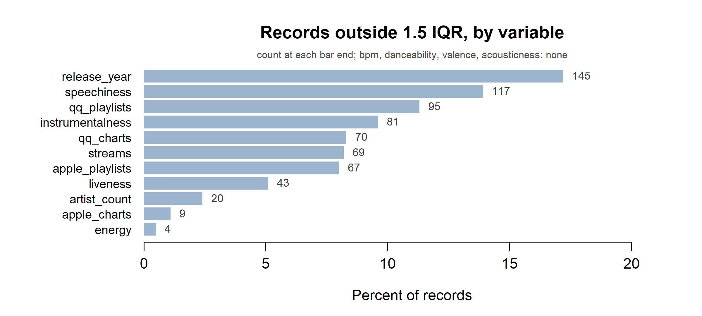

Two things follow, and the first is a decision not to act. The flagged records are not errors. The 69
songs outside the IQR on `streams` average 2.05 billion streams against 400 million for the rest; those
are the hits the question is about, and deleting them would leave a sample of mid-tier songs and answer
a different question. The same holds for `qq_playlists`, where the flagged group sits in 25,281
playlists on average. The heavy tail is the phenomenon rather than a defect in it, which is also why the
response is modelled on the log scale instead of being trimmed.

Second, where the flags fall follows the width of each column's middle half as much as its skewness. The
five columns closest to symmetry in Table 3 — `valence` 0.067, `danceability` −0.393, `bpm` 0.403,
`energy` −0.413, `acousticness` 0.949 — carry almost nothing: four are flagged zero times and `energy`
four times, 0.5%. The flags sit on the skewed columns, headed by `release_year` at 17.2%, `speechiness`
at 13.9% and `qq_playlists` at 11.3%. The order is not monotone in skewness — `speechiness` at 1.895
outranks `instrumentalness` at 6.654, and `acousticness` at 0.949 is clean while `energy` at −0.413 is
not — because a record is flagged only when it clears a fence built from that column's own quartiles.

Missingness gets one line rather than a figure, because a single incomplete column would draw a plot
with one bar: `key` alone is incomplete, at 89 records (10.6%), and Section 0 shows the gap is unrelated
to the response.

#### 1(a)(iv) Step 4 — `pairs.panels()`

`pairs.panels(dat[panel])` draws the whole grid in one call, with the ten variables that carry the
question rather than all fourteen candidates.

**Figure 3. `pairs.panels()` grid of the ten variables that carry the question.** Histograms on the
diagonal, Pearson coefficients with significance stars above, scatter plots with a fitted line below.

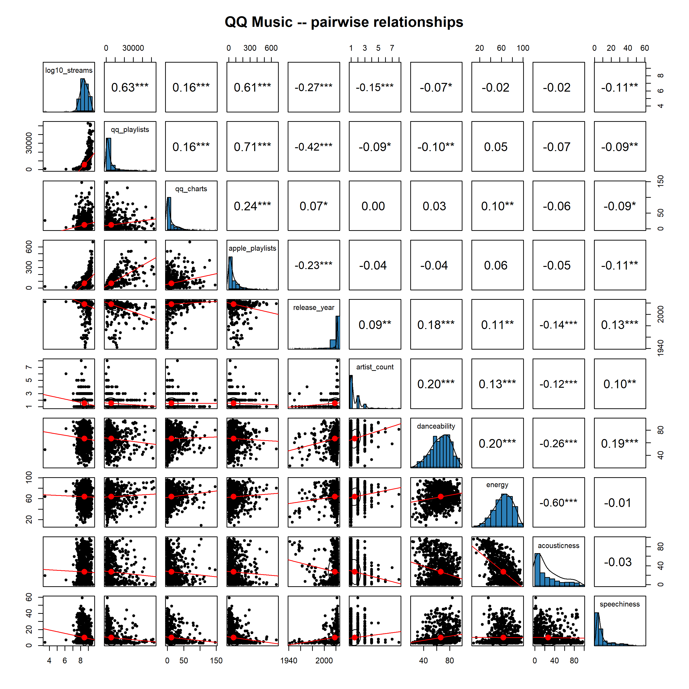

Across the top row, in the order the panel puts them: 0.63 for QQ playlists, 0.16 for QQ chart presence,
0.61 for Apple playlists, −0.27 for release year, −0.15 for artist count, and 0.11 at most in absolute
value for the four audio scores. Playlist exposure is the strongest companion of the response, release
timing is next, and content is flat. The lower triangles show the shapes behind those
numbers, which a coefficient cannot: the playlist relationship is convex in the raw scale, `release_year`
is bimodal with a cluster of recent releases, and `energy` against `acousticness` is a clear downward
cloud at −0.60.

The remaining figures take the parts of that grid the question needs at full size.

**Figure 4. Playlist exposure against streams.** Both axes log-scaled, the red line a lowess trend.

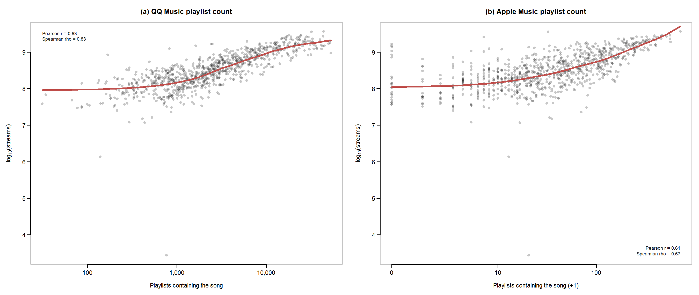

**Figure 5. Audio features against log10(streams),** one panel each. The y axis starts at 6 so that a
single catalogue record at 3.44 does not flatten every panel.

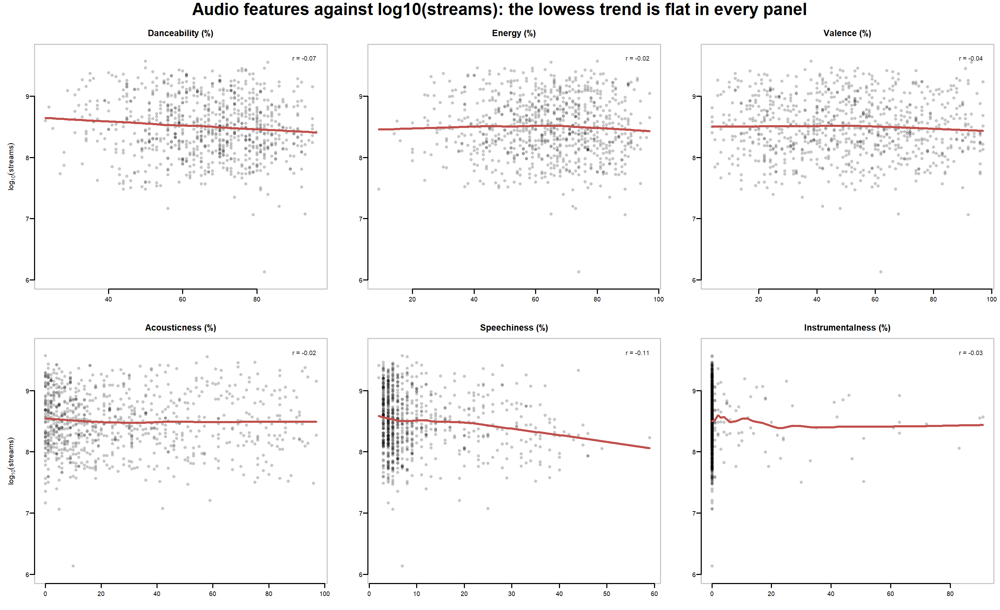

**Figure 6. Streams by release decade and by number of artists.** Panel (a) leaves out the two 1940s
records, which would be a group of two.

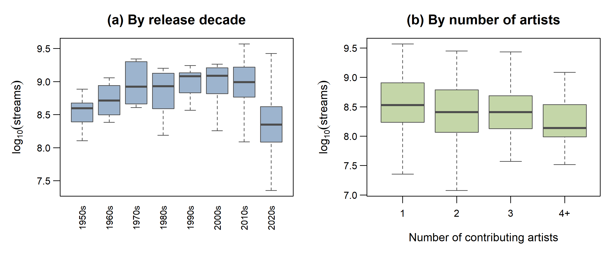

**Figure 7. Streams by chart presence** on each platform.

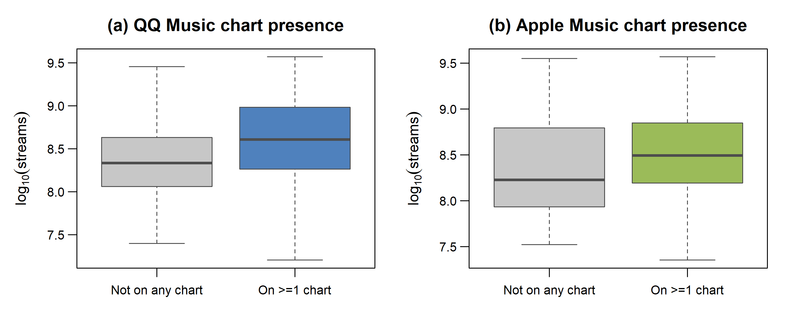

**Table 5. Association between each candidate predictor and log10(streams).**

| Predictor | Pearson r | Spearman ρ |
|:----------------------------------------|-------------------:|-------------------:|
| qq_playlists | 0.629 | 0.829 |
| apple_playlists | 0.610 | 0.668 |
| release_year | −0.270 | −0.682 |
| apple_charts | 0.264 | 0.335 |
| qq_charts | 0.159 | 0.270 |
| artist_count | −0.154 | −0.138 |
| speechiness | −0.108 | −0.122 |
| danceability | −0.072 | −0.090 |
| liveness | −0.050 | −0.063 |
| valence | −0.041 | −0.034 |
| instrumentalness | −0.026 | −0.004 |
| energy | −0.021 | −0.024 |
| acousticness | −0.020 | −0.052 |
| bpm | 0.010 | 0.010 |

Median streams are 215.9 million for songs on no QQ chart (n = 366) against 404.7 million for songs on
at least one (n = 476), and 338.5 million for solo records (n = 538) against 246.3 million for
collaborations (n = 304).

#### 1(a)(v) What the seven figures and four tables show

**1. The response has to be logged.** Streams run from 2,762 to 3.70 billion, six orders of magnitude,
and on the raw scale the histogram is one bin wide (Figure 1a). On the log10 scale the distribution is
centred near 8.48, about 301 million streams, with an interquartile range of 8.167 to 8.846. The
skewness of −1.298 there comes from two records below 10⁷; the first percentile is already 7.475. The
transformation buys scale and interpretability, and it does not make the response normal, which matters
when the residuals are checked in item 3.

**2. Playlist exposure dominates, and the two correlations disagree usefully.** `qq_playlists` has
r = 0.629 but ρ = 0.829, so the relation is strongly monotone and not linear. Figure 4 shows why: the
lowess curve is steep mid-range and flattens at both ends. Entering the raw count as a linear term would
understate the effect there and overstate it at the extremes, so the predictor is logged too.

**3. The audio features carry almost nothing.** All seven scores have |r| ≤ 0.108 with the response and
every lowess curve in Figure 5 is flat; speechiness (−0.108) and danceability (−0.072) are the largest,
tempo is 0.010. On this catalogue, what a song sounds like says little about how much it is streamed.

**4. Release timing matters, and Pearson understates it.** r = −0.270 against ρ = −0.682. Median log10
streams rise from 8.60 for 1950s releases to 9.09 for 2000s releases, then fall to 8.35 for the 2020s,
which is 222.8 million against 945.4 million for everything earlier. Most of this is a stock-versus-flow
effect, since streams accumulate, so timing has to be controlled and the pattern must not be read as
older music being better.

**5. Chart presence goes with about double the streams on both platforms.** Songs on at least one QQ
chart (476, 56.5%) have a median of 404.7 million against 215.9 million, a ratio of 1.87; Apple gives
312.6 against 168.7 million, a ratio of 1.85. The two platforms agree on the size of the gap while
disagreeing on the split, since 89.4% of records are on an Apple chart and that comparison rests on 89
songs. The agreement is reassuring, and the different base rates are a second sign that the two
`in_*_charts` columns are counts on different scales.

**6. Collaborations stream slightly less.** 246.3 million against 338.5 million, with `artist_count`
correlating −0.154. The effect is weak and probably confounded with era, which is one reason to read
nothing in this section causally.

**7. Three predictor pairs are collinear.** `qq_playlists` with `apple_playlists` (0.712), `energy` with
`acousticness` (−0.595), `qq_charts` with `apple_charts` (0.555), visible in the Figure 3 grid and in
Table 6. Two of these are the same mechanism measured twice, so both members of a pair should not enter
a model. A correlation matrix cannot say which to drop, so that is left to Item 3(a) and Item 3(b).

**Table 6. Predictor pairs with |r| > 0.5** (the course screen; the VIF threshold is 5).

| Pair | r | Consequence |
|:----------------------|--------:|:--------------------------------------------------------------------|
| `qq_playlists` — `apple_playlists` | 0.712 | do not enter both; keep the QQ measure |
| `energy` — `acousticness` | −0.595 | may both stay, but coefficients are unstable |
| `qq_charts` — `apple_charts` | 0.555 | do not enter both; keep the QQ measure |

---

### Item 1(b) — Research question [part of the 8 marks for item 1]

Exposure varies a lot between songs and tracks streaming closely; audio content barely does. The
question compares those two blocks with the confounders held constant.

> How strongly is a song's streaming performance on QQ Music, measured as log10 streams, associated
> with the platform exposure it receives — how many QQ Music playlists it appears in and whether it
> appears on the QQ Music charts — compared with its audio characteristics (danceability, energy,
> valence, acousticness, speechiness, instrumentalness, tempo and mode), once release timing and the
> number of contributing artists are held constant?

A Gaussian GLM with an identity link on the log scale answers it, and the brief allows an `lm()` fit.

**Response.** The response is `log10(streams)`. Four things support the transformation: the raw variable
spans six orders of magnitude, so a one-unit change in a predictor cannot have a constant effect on it;
its histogram is a single bin (Figure 1a); its relation with the main predictor is curved on the raw
scale and near-linear on the log scale (Figure 4), so logging fixes functional form as well as scale;
and the logged variable is roughly symmetric apart from two records (median 8.479, IQR 8.167–8.846),
which is closer to what the Gaussian assumption needs. The justification is functional form and
interpretability rather than normality. The practical gain is that a coefficient becomes an approximate
proportional change: 0.10 means about 10% more streams, which a product team can act on. A binary
hit/not-hit outcome was considered and rejected for the main question, because it would discard three
quarters of the variation and needs an arbitrary cut-off that would then drive the answer. No threshold
is used in this part; a binary version appears in Item 3(e) only as a robustness check.

**Candidate predictors.**

| Block | Variables | Why it is in the question |
|---|---|---|
| Platform exposure | `qq_playlists`, `qq_charts` (as a 0/1 indicator) | The lever the QQ Music team controls, and the strongest bivariate association |
| Audio characteristics | `danceability`, `energy`, `valence`, `acousticness`, `speechiness`, `instrumentalness`, `bpm`, `mode` | The content-based alternative; weak individually, so they have to be judged jointly |
| Controls | `release_year`, `artist_count` | Both confound exposure: older songs have accumulated streams, collaborations cluster in recent years |

`liveness` is one of the seven audio scores and the only one left out of that block: at r = −0.050 it is
the weakest of them and would add a term without carrying signal, so it stays in the descriptive tables
and out of the model. `mode` and `bpm` stay because they describe the recording itself rather than a
listener's response to it.

`qq_charts` enters as an indicator because it is zero for 43.5% of songs, its non-zero values are
extremely skewed (mean 12.4, maximum 147), and a linear term in the count would be driven by a handful
of records. The indicator is also the stronger linear predictor, r = 0.217 against 0.159 for the count,
since the count is monotone (ρ = 0.270) but bends sharply near zero. `track_name` and `artist_name` are
identifiers with no analytical role. `apple_playlists` and `apple_charts` measure the same mechanism as
their QQ counterparts and correlate 0.712 and 0.555 with them, so both would add variance without adding
information about QQ Music. `release_month` and `release_day` have no plausible mechanism behind them.
`key` is missing for 10.6% of records, and with eleven unordered levels it carries much the same
information as `mode`, which is complete and therefore kept.

**Relevance to the QQ Music team.** The question separates two strategies with very different costs. If
exposure still dominates once audio content is controlled, editorial playlist placement and chart
seeding are the levers worth funding and content-based prediction has a low ceiling on this data. If the
audio features keep explanatory power once exposure is held constant, a content-based recommender or a
pre-release screening tool has a real role, since content is known before release and playlist placement
is not. The fitted model also gives an expected stream range for a given playlist count, which is what a
planner needs when deciding how much promotion a release deserves.

**Limitation.** Playlist placement is plausibly a consequence of popularity as well as a cause, since
editorial teams add songs that are already moving. Any coefficient on `qq_playlists` therefore measures
an association rather than the effect of adding a song to a playlist, and the data cannot separate the
two directions. That is why the findings above say "associated with" rather than "increases", and why
the conclusion in item 3 must not be written as a return on promotion.

---

### Item 2 — Variable roles [5 marks]

Table 7 gives every variable a measurement scale (2a), an independent/dependent role (2b) and a
predictor/response role (2c) relative to the question in Item 1(b). The last two columns answer
different questions and are not always the same: `release_year` is both an independent variable and a
predictor, whereas `decade` is a grouping made for one plot and is neither.

**Table 7. Variable roles in relation to the research question.**

| Variable | Measurement scale | IV / DV | Predictor / response | Treatment |
|:---------------------|:--------------------|:-------|:-----------------------|:----------------------------------|
| `track_name` | Nominal (identifier) | neither | identifier | not used |
| `artist_name` | Nominal (identifier) | neither | identifier | not used |
| `streams` | Ratio | DV | source of the response | transformed to `log10_streams` |
| `log10_streams` | Interval (derived) | DV | **response** | primary response |
| `qq_playlists` | Ratio (count) | IV | **predictor** | entered as log10 |
| `qq_charts` | Ratio (count, 43.5% zeros) | IV | **predictor** | entered as `charted_qq` |
| `charted_qq` | Nominal (binary, derived) | IV | **predictor** | 1 if `qq_charts` > 0 |
| `apple_playlists` | Ratio (count) | IV | excluded | collinear with `qq_playlists` (0.712) |
| `apple_charts` | Ratio (count) | IV | excluded | collinear with `qq_charts` (0.555) |
| `charted_apple` | Nominal (binary, derived) | IV | excluded | same reason |
| `artist_count` | Ratio (discrete, 1–8) | IV | **predictor** | control |
| `collab` | Nominal (binary, derived) | IV | alternative | 1 if `artist_count` > 1 |
| `release_year` | Interval | IV | **predictor** | control for stream accumulation |
| `release_month` | Ordinal (cyclical) | IV | excluded | no plausible mechanism |
| `release_day` | Interval (discrete) | IV | excluded | no plausible mechanism |
| `bpm` | Ratio | IV | **predictor** | audio characteristic |
| `mode` | Nominal (binary) | IV | **predictor** | audio characteristic |
| `danceability` | Interval (0–100) | IV | **predictor** | audio characteristic |
| `valence` | Interval (0–100) | IV | **predictor** | audio characteristic |
| `energy` | Interval (0–100) | IV | **predictor** | collinear with `acousticness` |
| `acousticness` | Interval (0–100) | IV | **predictor** | collinear with `energy` |
| `instrumentalness` | Interval (0–100) | IV | **predictor** | 90.4% zeros |
| `liveness` | Interval (0–100) | IV | considered, not entered | weakest score (−0.050) |
| `speechiness` | Interval (0–100) | IV | **predictor** | audio characteristic |
| `key` | Nominal (11 levels) | IV | excluded | missing for 89 records |
| `decade` | Ordinal (derived) | neither | descriptive | Figure 6a only |
| `artist_group` | Ordinal (derived) | neither | descriptive | Figure 6b only |

Three assignments need a word. `track_name` and `artist_name` are nominal but label rows rather than
measure anything, so they are neither predictor nor response, which the brief allows; `artist_name` is
not used even as a grouping factor because 563 distinct names across 842 records would absorb almost all
the degrees of freedom. The seven audio scores are interval and not ratio, being bounded 0–100 indices
from an audio-analysis service with no natural unit, so equal spacing is a property of the scoring
scale; `bpm`, `streams` and the platform counts have a true zero and a meaningful ratio, and
`release_year` looks like a count but has no meaningful zero. The derived variables change scale:
`log10_streams` is interval on the log scale, where equal differences are equal proportional differences
in streams, while `charted_qq` and `collab` collapse counts into nominal binaries, losing information but
removing the skew in Table 3. That trade is worth it for `charted_qq` only because the collapsed version
correlates more strongly. `release_month` is ordinal rather than interval: months are unequal in
length and the series is circular, so December sits beside January rather than at the end of a scale.
`decade` and `artist_group` are not predictors: they regroup `release_year` and `artist_count` for the
two panels of Figure 6.

---

### Item 3 — A Gaussian GLM for streaming performance

**Ruiqi Gu (顾瑞祺)** — Role 5, Q4 modelling lead

The report answers the question in the order the question asks it: Section 0 sets out the input file and
the question, then Item 3(a) predictor reasoning, Item 3(b) correlation and multicollinearity, Item 3(c)
model specification and selection, Item 3(d) diagnostics and prediction, and Item 3(e) the conclusion
with the justification for the model. `Q4_GLM.R` is laid out in the same order, so the script can be read
beside the report, and every number here comes from it and can be reproduced by running it.

| Marked requirement | Where it is answered |
|:---------------------------------|:----------------------------------------------------------|
| (a) Predictor reasoning [6] | Item 3(a), Table 1, one row per candidate column |
| (b) Correlation and multicollinearity [4] | Item 3(b), correlation matrix and Table 2 (VIF) |
| (c) Model specification and selection [7], with two coefficients and their 95% CIs | Item 3(c)(i) response scale, family and link; 3(c)(ii) the nested comparison; 3(c)(iii) final formula, coefficients and CIs |
| (d) Diagnostics and prediction [6] | Item 3(d)(i) plots and statistics; 3(d)(ii) the prediction and its interval |
| (e) Conclusion and model justification [4], 200–300 words | Item 3(e)(i) and 3(e)(ii) the justification; 3(e)(iii) the conclusion, 290 words |
| The input file and the question, which the brief does not mark | Section 0 |

---

### 0. Setup: the input file and the question, before item 3

The analysis file is `data/QQ_Music_clean.csv` (n = 842, 25 columns), written by `Q4_EDA.R` and
included in this package. It removes two records from the raw 844: one duplicate on title, artist and
stream total, and one whose `streams` value is field-shifted and therefore has no usable response;
nothing was imputed. The response used here is `log10_streams`, a column already in that file.

The question being answered is the one set out in Item 1(b):

> How strongly is a song's streaming performance on QQ Music, measured as log10 streams, associated
> with the platform exposure it receives — how many QQ Music playlists it appears in and whether it
> appears on the QQ Music charts — compared with its audio characteristics, once release timing and
> the number of contributing artists are held constant?

The lab answer keys run every analysis through the same six steps — look at Y, plot, fit in R, read
3S, check, report. This part keeps that order: step 1 is Item 1(b) together with the response
discussion that opens Item 3(c), step 2 is the EDA figures of Item 1(a) plus the fitted curve in
Figure 2 here, step 3 is Item 3(c)(ii), step 4 is the 3S block in Item 3(c)(iii), step 5 is Item 3(d)(i)
and step 6 is Item 3(e).

---

### Item 3(a) — Which predictors enter, and why [6 marks]

Two variables need a word before the decisions, because their names mislead. `in_QQ_charts` and
`in_apple_charts` are described in the data dictionary as indicators, but they hold counts (0–147 and
0–275), so they are treated as counts. `qq_playlists` is a count spanning 31 to 52,898 and is entered on
the log scale.

**Table 1. Predictor decisions.**

| Variable | Decision | Reason |
|:--------------------------|:------------|:------------------------------------------------------|
| `log10(qq_playlists)` | in | The exposure measure the team controls, and the strongest correlate of the response (ρ = 0.829). The log form is empirical: the raw count gives AIC = 807.8 and adjusted R² = 0.411, against AIC = 416.4 and 0.630 in log form |
| `charted_qq` | in | The second exposure channel, acting at a different margin: a song can sit in thousands of playlists without charting. The count form was rejected on evidence — replacing the indicator with `log1p(qq_charts)` raises AIC from 405.4 to 432.3 and lowers adjusted R² from 0.6357 to 0.6238 |
| `release_year` | in | Streams are a cumulative stock, so a 1975 record has had five decades to accumulate. Omitting it would confound every other coefficient |
| `artist_count` | in | A plausible distribution advantage; blocked with `release_year` so that the joint contribution of release context can be tested |
| `danceability`, `valence`, `energy`, `acousticness`, `speechiness`, `instrumentalness` | in | The six 0–100 audio scores, the block the question is built around. They enter together and are tested jointly, since dropping any of them in advance would beg the question |
| `bpm`, `mode` | in | The two remaining audio descriptors, kept so that "audio characteristics" means the whole recorded sound rather than only the scores. `mode` is a two-level factor, `bpm` a count |
| `liveness` | out | The seventh score and the only audio variable left out: r = −0.050 (ρ = −0.063) with the response, the weakest of the nine, and Item 2 had already recorded it as considered but not entered. Leaving it out keeps the joint audio test at 8 degrees of freedom instead of 9 |
| `track_name`, `artist_name` | out | Identifiers. Artist identity would need hundreds of fixed effects or a random effect, which is outside this model |
| `release_month`, `release_day` | out | No mechanism links a calendar day to cumulative streams; any effect would proxy promotion scheduling |
| `key` | out | Missing for 10.6% of records, and its 11 observed levels would cost 10 degrees of freedom for a weak hypothesis |
| `apple_playlists`, `apple_charts` | out | Collinear with their QQ counterparts (0.712 and 0.555) and not actionable for the QQ Music team |
| `charted_apple`, `collab` | out | Derived binaries of variables already decided on. `charted_apple` is `apple_charts` > 0, an Apple-side channel only weakly tied to `charted_qq` (r = 0.158) and outside the research question; `collab` is `artist_count` > 1 and correlates 0.815 with the count it is built from, so it adds no information |
| `decade`, `artist_group` | out | Groupings built for the two descriptive panels of item 1(a), not variables in their own right: they recode `release_year` and `artist_count`, both of which enter in their measured form |
| `streams` untransformed | out | Two records sit over three orders of magnitude below the median and the raw-scale residuals are heteroscedastic |

---

### Item 3(b) — Correlation and multicollinearity [4 marks]

Thirteen predictors are numeric, giving a 13 × 13 matrix and 78 pairs, with the response excluded. The
median absolute correlation is 0.067, and only three pairs exceed |r| = 0.5: `qq_playlists` with
`apple_playlists` (0.712), `energy` with `acousticness` (−0.595), `qq_charts` with `apple_charts`
(0.555). The first and third are the same mechanism measured on two platforms; the second is
structural, since an acoustic recording is low-energy by construction. The two categorical
predictors, `charted_qq` and `mode`, cannot enter a correlation matrix; they are assessed as dummy
columns in the VIF below.

Restricted to the twelve terms that actually enter the candidate model, `energy` with `acousticness` is
the only pair above 0.5 and 0.595 is the largest absolute correlation of any kind, so the two platform
pairs are a property of variables that are excluded anyway.

VIF was computed on the full candidate model, which is the most conservative case because every
predictor is in it at once.

**Table 2. VIF for the full candidate model (course threshold: 5).**

| Term | VIF | Term | VIF |
|:---------------------------|---------:|:---------------------------|---------:|
| energy | 1.871 | speechiness | 1.098 |
| acousticness | 1.734 | charted_qq (Yes) | 1.076 |
| valence | 1.502 | artist_count | 1.065 |
| danceability | 1.470 | bpm | 1.052 |
| release_year | 1.337 | instrumentalness | 1.034 |
| log10(qq_playlists) | 1.244 | mode (Minor) | 1.032 |

Nothing approaches 5, so the estimates are not inflated by collinearity. The cross-platform pair is
removed by design rather than by trial and error: `apple_*` never enters the primary model, which keeps
the exposure coefficient interpretable as a QQ-specific association. `energy` and `acousticness` are
correlated but both have VIF below 2, so neither needs dropping; a structural pair of that kind is
better handled by testing the eight audio terms as a block, which is what Item 3(c) does.

---

### Item 3(c) — Model specification and selection [7 marks]

#### 3(c)(i) Response scale, family and link

A Gaussian family with an identity link is used, fitted with `lm()` on log10 streams. Three things rule
out an untransformed fit: the response spans six orders of magnitude (2,762 to 3.70 billion), its raw
histogram is a single bin, and its relationship with playlist count is straight only in logs. A Poisson
or negative-binomial model was considered and rejected on the variance: Var/mean for `streams` is
6.4 × 10⁸, which no count model accommodates, and streams are a cumulative total rather than events in a
fixed exposure window.

`glm()` with `family = gaussian(link = "identity")` returns the same fit — the script fits both and
`all.equal()` comes back TRUE for the coefficients and for the deviance — so the choice between the two
functions is notation rather than substance. `glm()` reappears in Item 3(e) with a binomial family and a
logit link, where the family does the work.

The link is the identity rather than a log link, because the logarithm has already been applied to the
response: the constant-variance assumption is being made on the log scale, where the residuals of the
final model (Figure 1) show a flat spread. A log link on raw `streams` would instead assume a constant
variance in streams, contradicted by a range that runs from 2,762 to 3.70 billion.

A coefficient on this scale is an approximate proportional change: 0.10 corresponds to about 10% more
streams.

#### 3(c)(ii) The nested comparison

Three nested models were compared, so that each block can be tested in the order the question implies.

```
M1: log10(streams) ~ log10(qq_playlists) + charted_qq
M2: M1 + release_year + artist_count
M3: M2 + danceability + energy + valence + acousticness
       + speechiness + instrumentalness + bpm + mode
```

**Table 3. Model comparison** (k = number of predictors; residual SE is on the log10 scale).

| Model | k | R² | Adjusted R² | AIC | BIC | Residual SE |
|:--------------------------|---:|-----------:|------------:|-----------:|-----------:|------------:|
| M1 exposure only | 2 | 0.6308 | 0.6300 | 416.41 | 435.35 | 0.3089 |
| M2 + timing/artist | 4 | 0.6374 | 0.6357 | **405.35** | **433.77** | 0.3065 |
| M3 + audio features | 12 | 0.6425 | 0.6373 | 409.47 | 475.77 | 0.3059 |

M1 → M2: F(2, 837) = 7.549, p < 0.001, so the controls belong. M2 → M3: F(8, 829) = 1.473, p = 0.163,
so the eight audio features add nothing jointly. They buy 0.005 of R² while raising AIC by 4.1 and
BIC by 42.0, and all three criteria point the same way. **M2 is the final model.**

This is the answer to the research question rather than a technicality: the audio block is not merely
non-significant, it is jointly not supported as an incremental block by this test once exposure is present. That bounds how
much a content-based recommender could add on top of distribution information.

#### 3(c)(iii) The final model, its coefficients and their intervals

**Final model (M2).**

*log10(streams) = 3.758 + 0.670·log10(qq_playlists) + 0.159·charted_qq + 0.001·release_year − 0.048·artist_count*

Fitted as `log10_streams ~ log_playlists + charted_qq + release_year + artist_count`, where
`log_playlists = log10(qq_playlists)` and `charted_qq` is a two-level factor.

F(4, 837) = 367.8, p < 0.001; R² = 0.637; residual SE = 0.307 on 837 df.

**Table 4. Final model coefficients.**

| Term | Estimate | SE | t | p | 95% CI |
|:------------------------------|-----------:|----------:|----------:|----------:|:--------------------------|
| (Intercept) | 3.758 | 2.155 | 1.74 | 0.082 | (−0.472, 7.987) |
| log10(qq_playlists) | 0.670 | 0.020 | 33.56 | < 0.001 | (0.631, 0.709) |
| charted_qq (Yes vs No) | 0.159 | 0.022 | 7.35 | < 0.001 | (0.117, 0.201) |
| release_year | 0.001 | 0.001 | 1.15 | 0.250 | (−0.001, 0.003) |
| artist_count | −0.048 | 0.013 | −3.78 | < 0.001 | (−0.073, −0.023) |

**Read: 3S.** The two coefficients the question turns on, read the way the lab answer keys read them:
sign, size on the response scale, and certainty.

**3S for the two coefficients.**

| 3S | `log10(qq_playlists)` | `charted_qq` (Yes vs No) |
|:---------|:--------------------------------------------------------|:--------------------------------------------------------|
| **Sign** | β̂ = 0.670, positive | β̂ = 0.159, positive |
| **Size** | 10% more playlists goes with 1.066× the streams, i.e. **6.6% more** (95% CI 6.2% to 7.0%); a doubling with 1.591×, i.e. 59.1% | **1.442×** the streams, i.e. **44.2% more** (95% CI 30.8% to 59.0%) |
| **Sure** | t = 33.56, p < 0.001 | t = 7.35, p < 0.001 |

Neither number is a change in streams: 0.670 and 0.159 are changes in log10 streams, so "0.670 more
streams" would be wrong. On the response scale the effects are 6.6% and 44.2%, which is how they are
reported below.

**Playlist exposure.** Holding chart presence, release year and artist count fixed, and with playlists
already in logs, the coefficient is an elasticity: 10% more playlists goes with 6.6% more streams, and a
doubling with 59.1%. The confidence limits translate to between 6.2% and 7.0% per 10%, so both the
direction and the magnitude are well determined. This is the largest effect in the model by a wide
margin.

**Chart presence.** Holding playlist count and the controls fixed, a song on at least one QQ chart is
associated with 44.2% more streams (95% CI 30.8% to 59.0%). The direction is precise; the size is
pinned down only to within a factor of about two. The comparison is also a strong one, since charting
and playlist placement move together in practice.

**Controls.** `release_year` is not significant once exposure is controlled (p = 0.250), which is
informative rather than disappointing: on its own the year slope is −0.012 per year (p < 0.001), but
pre-2010 records sit in a median of 13,893 playlists against 2,045 for later ones, so the era pattern
works through distribution rather than through age. `artist_count` is negative
and significant, at −10.4% per extra artist. That is counter-intuitive and is taken up in the
conclusion.

The playlist coefficient is stable across specifications (0.667 in M1, 0.670 in M2, 0.675 in M3), so
the headline result does not depend on which of the three models is chosen.

---

### Item 3(d) — Diagnostics and prediction [6 marks]

#### 3(d)(i) Diagnostics

**Figure 1. Diagnostic plots for the final model.**

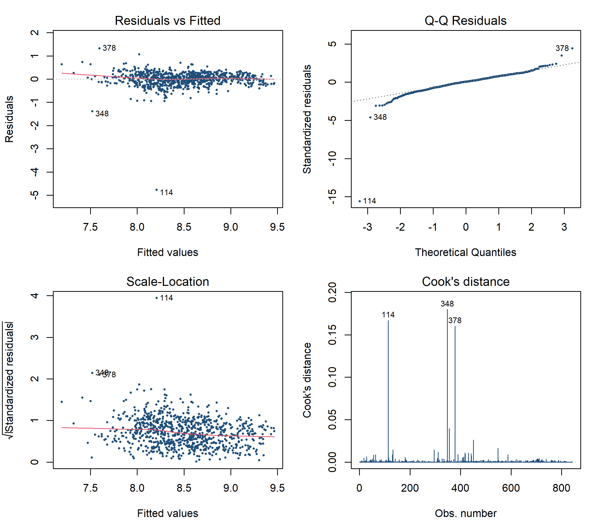

**Linearity and variance.** The residuals-versus-fitted smoother is not quite flat. Averaged in
eighths of the fitted range, the mean residual is +0.10 in the lowest eighth, dips to −0.13 just
below the middle of the range, and is back to +0.02 in the highest: a shallow U. A quadratic term in `log_playlists`
confirms it is detectable (F(1, 836) = 9.63, p = 0.002) with a positive coefficient, so the fit is
slightly too straight — the slope is right on average, the curvature is not modelled. Its size is
small — R² rises from 0.6374 to 0.6415, the residual SE falls from 0.307 to 0.305 and AIC by 7.6 —
and the fitted values move by 5% or less between 1,000 and 5,000 playlists, by 11% at 20,000, and by
28–31% only at 100 and 50,000, outside the central 98% of the distribution, where 8 and 3 songs sit.
The linear-in-logs form is kept, because a single elasticity is the quantity the question asks about
and the misfit lives in the tails; the shallow curve is carried into the limitations rather than
fitted away.

Constant variance holds: the scale-location plot is flat apart from three isolated points, and
Breusch-Pagan does not reject (LM = 6.11, df = 4, p = 0.191). Two further specification checks. An
interaction between chart presence and playlist count is not supported (F(1, 836) = 0.07, p = 0.789),
so the chart effect is additive as assumed. And the response scale is supported directly: the same
four predictors fitted to untransformed `streams` give a residual standard error of 3.6 × 10⁸ against
a mean of 5.4 × 10⁸ — 68% of the mean — with R² down to 0.617, the comparison behind the choice made
in Item 3(c)(i).

**Normality.** The Q-Q plot follows the line through the body of the distribution and departs at both
tails; Shapiro-Wilk rejects normality (W = 0.787, p < 0.001). The departure comes from the two
catalogue recordings with under 10⁷ streams: the lower of them, *Que Vuelvas* (2,762 streams), sits
4.77 log units below its fitted value. Normality matters for the small-sample behaviour of the t and
F tests rather than for the estimates themselves, and with 837 residual degrees of freedom the tests
are not sensitive to this departure.

**Influence.** No observation reaches a Cook's distance of 1; the largest is 0.180 for *Jhoome Jo
Pathaan*, a high-leverage record with no visible effect on the coefficients and well below the 0.5 rule
of thumb. Seven studentized residuals exceed 3 in absolute value, five of them negative. Deleting them
was therefore unnecessary, and would have removed genuine hits.

#### 3(d)(ii) Prediction

Take a plausible song whose profile sits inside the observed range of every predictor in the final
model: playlists run from 31 to 52,898, release year from 1942 to 2023, contributing artists from one
to eight, and chart presence is a 0/1 indicator. The profile used is a 2022 single by one artist, in
5,000 QQ Music playlists (the 71st percentile) and on the QQ charts.

- predicted log10 streams 8.801, i.e. about **633 million**;
- 95% confidence interval for the mean log response (back-transformed to the geometric mean): (8.768, 8.835), 586–684 million;
- 95% prediction interval for this individual song: (8.199, 9.404), **158 million to 2.54 billion**.

**Table 5. Predictions for three exposure profiles** (all 2022, one artist).

| Profile | Playlists | Predicted streams | 95% prediction interval |
|:---------------------------------|------------:|-----------------------:|:-------------------------------|
| Low exposure, not charted | 300 | 66.6 million | 16.6 – 267.4 million |
| Reference, charted | 5,000 | 633.0 million | 158.0 – 2,535.4 million |
| High exposure, charted | 20,000 | 1,602.8 million | 399.3 – 6,433.7 million |

The two intervals answer different questions and the difference between them is the honest part of
the result. The confidence interval says how well the mean log outcome for this profile is pinned
down, and it is narrow because 842 records determine a mean well. The prediction interval says where
one new song would fall, and it spans a factor of sixteen, so for a single song that is the interval to
quote. A point forecast of 633 million is therefore better reported as "somewhere between about 160
million and 2.5 billion", which is a statement about the song-to-song variation the model leaves in
place.

**Figure 2. Fitted relationship and coefficient estimates.**

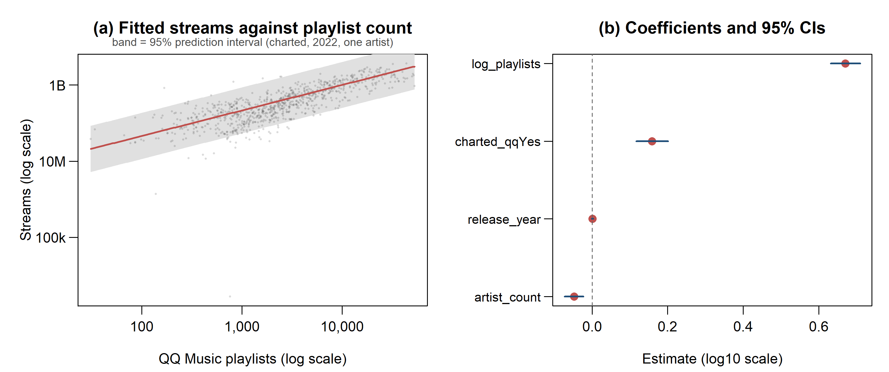

Panel (a) shows the fitted curve and prediction band across the observed playlist range: straight in
log-log space, with the band widening only slightly at the extremes.

---

### Item 3(e) — Conclusion and model justification [4 marks]

#### 3(e)(i) Justification 1: the ranking survives a change of response scale

Item 1(b) rejected a hit/not-hit outcome for the main question because the cut-off is arbitrary. It is
still useful as a check that the ranking of predictors does not depend on the choice of response
scale. Defining a hit as streams above the 75th percentile (701,997,830; 211 songs, 25.1%) and
refitting the same four predictors with a logit link gives `log10(qq_playlists)` 7.003 (SE 0.576,
p < 0.001), `charted_qq` 1.015 (p < 0.001), `release_year` 0.034 (p = 0.003) and `artist_count`
−0.519 (p = 0.010), with McFadden pseudo-R² = 0.621. A doubling of playlist count multiplies the odds
of being a hit by about 8.23 (`exp(7.003 × log10(2))`). The same variables come out in the same order with the same
signs, so the substantive conclusion is not an artefact of the log-linear specification.

#### 3(e)(ii) Justification 2: why this model rather than a larger or a different one

The choice is supported on three counts, each tested where it was reported. The four-parameter model is
preferred by AIC and BIC (M3 has slightly higher adjusted R²) and by a nested F test that
cannot reject the audio block (p = 0.163), so the eight extra terms are not earning their place — the
more parsimonious model is preferred on these data; out-of-sample performance was not tested. Collinearity cannot be blamed for that
result: no VIF exceeds 1.9, and the largest correlation among the twelve terms that enter is −0.595
between `energy` and `acousticness`, both of which stay because neither is redundant on its own. And
the coefficients are stable: the playlist elasticity moves only between 0.667 and 0.675 across the
three specifications, and the ranking is unchanged under a logit link on a binary outcome.

What the model cannot do is identify a causal effect. Playlist placement follows popularity as well as
causing it, so the coefficients describe differences between songs rather than the return on a
decision.

#### 3(e)(iii) Conclusion

Across 842 songs, this report asked how strongly a song's streaming performance on QQ Music is
associated with the exposure it receives, compared with its own audio characteristics, once release
timing and artist count are held constant. The answer is exposure, by a wide margin. The two exposure
variables alone explain 63.0% of the variation in log10 streams. Adding the eight audio features raises
R² by 0.005, fails a joint F test (F(8, 829) = 1.47, p = 0.163) and worsens both AIC and BIC, so the
four-parameter model without audio content is preferred: playlist count (β = 0.670), chart presence
(β = 0.159), release year and artist count (β = −0.048), with R² = 0.637.

In practical terms, 10% more playlist placement goes with 6.6% more streams and appearing on a chart
with 44% more, while no audio characteristic shows a meaningful association on its own. For the QQ
Music team this bounds what content-based prediction can add beyond distribution signals.

Three limitations should be kept in view. The design is cross-sectional and observational, and
playlist placement is plausibly a consequence of popularity as much as a cause, so these are
associations rather than the returns from adding a song to a playlist. Streams are cumulative and the
sample is dominated by recent releases, so the weak release-year coefficient after adjustment is not
evidence that a song's age is irrelevant. And the model leaves 36% of the variance unexplained, its
residuals keep a shallow curve and its Q–Q plot departs in both tails, and the prediction interval
spans a factor of sixteen, so a point forecast carries real uncertainty; the negative artist-count
coefficient is also counter-intuitive and probably reflects unrecorded genre differences rather than a
penalty for collaboration.

---

## Data sources and assistance

- Q1 scores: course Assignment 3 handout. Q2: `datasets::chickwts`. Q3: `ISLR2::Hitters`, `ISLR2::College` and `ISLR2::Auto`. Q4: course-provided `QQ_Music.csv`.
- The group’s original analyses and R code were adapted for the combined report. AI assistance was used to organize the submissions, consolidate code, check statistical interpretations and edit the English report. The combined script was rerun in R 4.6.1 to verify reported results.
